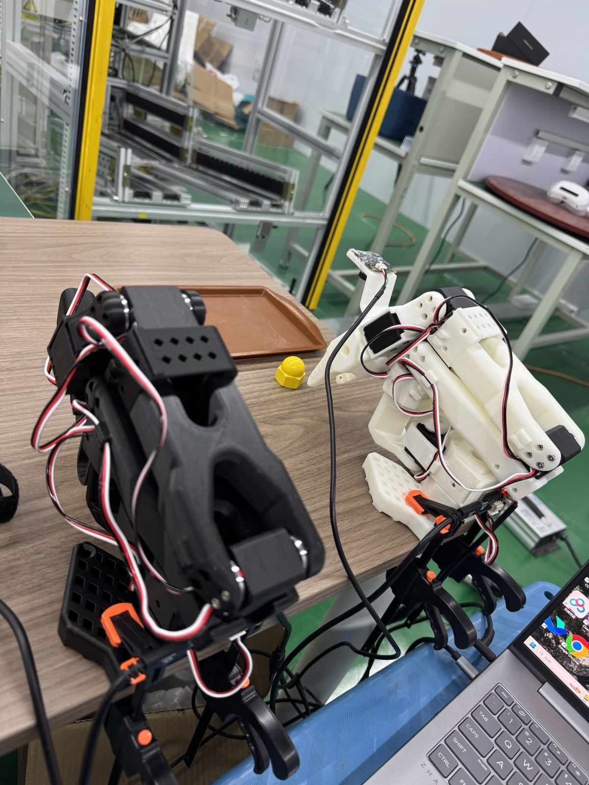
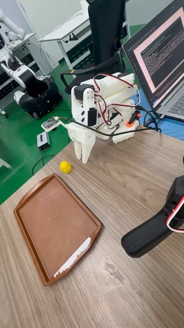

<a name="overview"></a>

# 00｜先看我们实际完成了什么

[教程目录](../README.md) · [下一章](01-roadmap.md)

> **学习目标：建立全流程地图**
>
> 把数据、模型、执行器和任务结果分开看。

任务是：看见桌上的一颗黄色螺母，用 SO-101 夹起，搬运至前方棕色盘，松爪并后撤。输入指令固定为 `Pick up the yellow nut and place it into the brown tray.`。这是一个单物体、单任务、相近桌面条件下的模仿学习项目。

从零到一可以沿着下面这条线理解：

```text
环境与校准 → 主从跟随 → 一条试采 → 连续50条正式示范
→ 文件/视频/状态动作验收 → 45/5整条划分 → 训练集统计
→ 官方SmolVLA预训练权重微调 → 12000步结束并保留检查点
→ 第5000步离线检查 → 模型预测接入受限执行器
→ 修复队列、时序、夹爪与固定起点 → 参考设备完成抓放
→ 模型、数据、复现代码和演示公开归档
```

| 已有结果 | 本项目实际值 |
|---|---|
| 正式数据 | 50 episodes，29570帧，标称30FPS，约16分26秒 |
| 训练 / 验证 | 45条26722帧 / 5条2848帧，按整条隔离 |
| GPU | RTX 5060 Laptop，8GB显存 |
| 可训练参数 / 总参数 | 99,880,992 / 450,046,176 |
| 实际训练 | batch 8，BF16，12000次优化更新 |
| 选用模型 | 第5000步，保留集 Flow Matching loss = 0.2090 |
| 执行器 | v7，完整预测段、共同策略进度、固定起点与两次Enter |
| 现场结论 | 操作员确认完成任务，并提供成功视频 |

成功案例对应现场确认。参考日志 `step005000-20261020T094811` 因45秒上限结束，没有S键成功标签；不能把该退出原因写成自动成功识别。当前没有多次独立试验的统计成功率，也未验证新设备、新光照或大范围物体变化。

### 现场材料：初始摆放与完整成功案例



[](https://github.com/damonwangk/so101-yellow-nut-smolvla/releases/download/v1.0.0/success-demo.mp4)

[观看或下载完整成功视频](https://github.com/damonwangk/so101-yellow-nut-smolvla/releases/download/v1.0.0/success-demo.mp4)。用户提供的55.33秒现场案例，保持原动作顺序；它不计入50条训练示范，也不替代重复实验的成功率统计。精确固定准备姿态仍以episode22关节配置及腕部图为准。

## 三种信息怎样区分

**官方机制**来自 SmolVLA / LeRobot 0.6.1 源码；**本项目实现**来自实际采集器、训练封装、执行器和保存配置；**教学示意**是帮助理解的动画，不是网络中间激活、真实机器人仿真或新的实验结果。下面的交互组件均标明数据来源。

---

**停一下，用自己的话回答：** 已经有视频，为什么还要采action？

<details>
<summary>参考答案</summary>

视频展示发生了什么，action记录控制器要求电机去哪里。模仿学习需要后者作为监督，不能从手机视频可靠恢复。

</details>

[教程目录](../README.md) · [下一章](01-roadmap.md)
