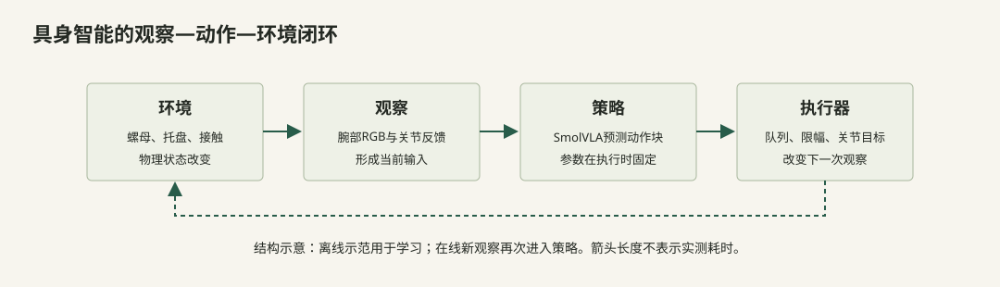
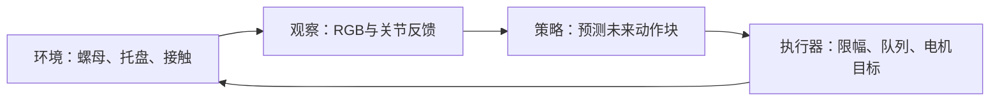

# 01｜具身智能入门：用这个任务建立学习路线

[教程目录](../README.md) · [上一章](00-overview.md) · [下一章](02-setup.md)

> **学习目标：认识具身智能的闭环**
>
> 能指出观察、策略、动作和环境反馈各在哪里。

## 用这一个任务建立完整的学习骨架

你已经完成一个真实的视觉语言动作策略微调案例：在固定桌面上，用主从遥操作收集单黄色螺母示范，在8GB显卡上微调SmolVLA，再通过带边界和时序处理的执行器完成实机抓放。接下来学习的目标，是能解释每个接口、查出典型问题并设计可信评估，而不只是记住启动命令。

这条路线按“先认识对象，再追踪一份数据，最后理解学习与控制”安排。每阶段都有可以在现有离线材料中完成的小练习；不需要为做题启动机械臂或训练。能够完成阶段产出，再进入下一阶段，比按天数赶进度更有用。

查看Mermaid图源码

离线学习：人示范 → 保存图像/state/action → 更新参数θ。在线执行：新观测 → 固定参数θ预测 → 受限目标 → 新观测。本轮真机运行没有继续做梯度更新。

## 阶段1：把机器人看成一条可观测的因果链

**要掌握：** 相机是观测通道；编码器反馈形成状态；策略输出目标；控制器受限后向电机发送；机器人与环境交互，产生下一次观测。视觉、运动和物理接触是不同层，不能只看其中一层来判整个系统。

画出本项目闭环：`RGB + 当前关节位置 + 任务 → 模型 → 未来目标块 → 执行器 → 电机/夹爪 → 场景变化 → 新RGB/状态`。把操作者、从臂、主臂、相机、显卡分别放入图中。主臂属于采集/人工复位链路，正式自主模型推理不需要主臂提供动作标签。

**小练习1：** episode22第245帧夹爪 `state=35.123`、`action=33.123`，能否推断“螺母受到了2单位夹持力”？

参考答案与理由

不能。这里差值是约−2.000个开度百分点，表示发送的目标比实测位置更闭合；它不是力传感器读数。物体阻挡、机构弹性、摩擦、电机控制和目标更新都会影响实际夹持。现有位置日志可以解释请求与跟踪，不能直接测力。

**阶段产出：** 你能分别说清 state、目标action、实际运动与任务结果各由什么证据支持，也能解释为什么“目标已经发送”不等于“物体已被抓牢”。

## 阶段2：从数字数组到 Tensor，不急着背网络名词

**要掌握：** shape描述轴；dtype描述数值表示；batch是把多个独立样本按轴叠起来；时间轴与batch轴含义不同。图像像素、关节状态、文本token不必采用同一种编码。

用本任务复述：一张RGB图像解码为 `[3,480,640]`；Parquet中的一个6维状态为 `[6]`，官方训练reader保留一个观察时刻后为 `[1,6]`；一个未来50步标签为 `[50,6]`。8个锚点样本经DataLoader堆叠后分别是 `[8,3,480,640]、[8,1,6]、[8,50,6]`。这里8不是8个连续视频帧，也不是8个相机。

**小练习2：** `[8,50,6]`一共有多少个动作标量？t=480的episode22有490帧，标签窗口中多少个时间步应计算损失？

参考答案与理由

8×50×6=2400个标量。以480为锚点，480…489共10步有效；490…529超出本episode，另外40步是补齐，不能作为40次新的真实动作监督。正确形状与正确有效性是两件事，要同时看 `action_is_pad`。

**小练习3：** 把两个 `[6]`状态放在同一个列表里，为何通常得到 `[2,6]`，而不是 `[12]`？

参考答案与理由

堆叠新增了batch轴，保留每个样本的六通道结构；拼接才可能把它们连成12维。若把batch轴拼进关节轴，网络就把“两台次的样本”误解为“一个12关节状态”。参照本教程真实数据到batch的代码，辨认 `stack` 与维度变换即可，不需要先训练网络。

**阶段产出：** 随手指出任意模型输入的每条轴是什么意思，并能沿着一个真实锚点从文件追到 `[B,H,D]`动作窗口。

## 阶段3：理解 MLP、Attention 与 Flow Matching 各自解决什么

**要掌握：** 先理解计算，再记名称。

- **MLP/线性投影：** 把输入向量映射到另一种特征空间。比如补齐后的32维关节状态经过投影成为960维token；它增加的是可学习的表达，不是凭空增加新的传感器信息。
- **Attention：** 根据当前查询与可见内容的相关性，混合其他token的信息。它让动作计算能使用图像、指令、状态及动作块内部关系；mask约束哪些信息可见，网络不会天然知道正确边界。
- **Transformer：** 把attention、逐token的前馈网络、残差与归一化组成多层特征更新。深层向量是条件表示，不再与“第一个维度就是黄色”这种手工含义逐一对应。
- **Flow Matching：** 训练网络在噪声与真实动作之间的中间点预测速度方向；推理从噪声开始按该速度场积分，得到一个动作块。积分步数是求解过程的迭代数，与50个未来动作时间步不同。

**小练习4：** 状态从6维补到32维，随后投影到960维，这是否意味着机器人从6自由度变成960自由度？若一次推理有10次积分，是否只输出10个动作？

参考答案与理由

都不是。32/960是网络接口与隐藏表示，真实输出仍截取本任务的6个动作通道。10次积分是在同一个 `[50,32]`含噪动作块上反复求解；最后仍可输出 `[50,6]`，再由执行器分时发送。

**小练习5：** 用本教程的标量Flow Matching例子，只保留一个动作通道，手算一次 `x_next = x + dt * v`；说明这个手算是教学示意，还是某次真实机器人的预测日志。

参考答案与理由

手算规则是将步长乘预测速度再加到当前点；结果取决于例题中给出的x、dt和v。它是帮助理解积分的低维示意。只有从真实推理日志读取的输入、随机状态、模型权重和输出才能对应一次真实预测，不能把示意曲线当模型实际产生的关节轨迹。

**阶段产出：** 可以向别人解释图像/文本/状态如何成为条件，为什么动作块不是聊天文本，为什么训练中加入噪声、推理中需要积分；再回到对应代码确认维度和mask。

## 阶段4：以数据工程师的方式解释每条示范

**要掌握：** 数据契约、时间语义、任务语义、QC证据、版本与划分。先阅读数据工程章节，再亲自做下面的判断。

**小练习6：** 对真实条0、3、30各写一行：“观察事实 → 对训练的可能影响 → 本轮处置”。不能把推测写成实测结论。

参考答案与理由

条0：前段较慢对位，约24.5秒释放入盘 → 较多纠偏/等待采样位置，可能影响动作风格 → 成功且完整，软备注保留。条3：约20秒成功，随后约7.7秒静止尾段 → 静止监督比例偏多 → 本轮保留，可在有版本副本上试裁剪。条30：约15秒成功，18.5秒后出画 → 后段信息少并可能包含不必要后撤 → 成功证据此前成立，软备注保留。这里没有哪条被本轮判为必须删除。

**小练习7：** 为什么同一条episode的奇数帧训练、偶数帧验证会得到令人误判的好结果？怎样检验对新物体位置的能力？

参考答案与理由

相邻帧和动作窗口高度重叠，相似画面及49/50重叠标签同时出现在两边，使验证不再独立。至少按整条episode隔离；若要声称泛化到未见位置，还应按位置组保留测试条件，而不是只把同一位置的新一条示范放入验证。训练统计只能来自训练侧。

**阶段产出：** 能为一条样本给出可复核的质量标签，并区分硬错误、软备注与待复核；能设计一份与评估目标一致的划分说明。

## 阶段5：看懂一次梯度更新，而不是只盯 loss

**要掌握：** batch前处理 → 冻结VLM提供条件 → 动作专家预测流速度 → 有效区域损失 → 反向传播 → 可训练参数更新 → 按验证结果比较检查点。冻结模块仍参加前向计算，不等于模型不用它。

本次8GB配置的关键是冻结VLM、训练约9988万参数、BF16、batch8，并使用官方数据与模型接口。训练45条，验证5条；训练最终在12000步验证和保存后结束，选用保留集loss最低的5000步模型。你应能在真实曲线中找出 `5000:0.2090` 和 `12000:0.2288`，说明选择依据。

**小练习8：** 训练loss继续下降，但验证loss在5000步之后没有改善，应当自动加更多步吗？0.2090能否转换为79.1%的抓取成功率？

参考答案与理由

不应仅按训练loss继续加步。先比较保留集表现、模型行为与任务失败分布，必要时做固定条件实机评估；当前已经保留全部检查点，选择5000步有明确依据。0.2090是本实现的流速度回归损失，不是失败概率，不能用1−loss求成功率。

**阶段产出：** 能画出哪些参数更新、哪些不更新；解释优化步、epoch、batch、动作窗口和积分步彼此的区别；从原始日志找到配置与模型选择证据。

## 阶段6：把“模型输出”与“机器人执行”接起来

**要掌握：** 策略预测50步不代表驱动每次立即执行完50步；控制频率、限速、反馈、异步推理与动作队列共同决定现场轨迹。一个模型可能已经预测了松爪，但执行器持续覆盖尾段，机器人仍不会松爪。

使用离线交互包中的队列动画：先看旧15帧接入为什么会把较后的释放持续截掉，再看完整剩余50步段、身体限速后的实际策略时间、最终关键帧保留。注意这个对照解释的是执行时序，不是物理抓持仿真。

**小练习9：** 控制60 Hz、策略30 FPS时，正常每个控制周期推进多少策略帧？若身体限速只接受提议进度的一半，夹爪应该取原提议时刻还是实际接受时刻？

参考答案与理由

正常最多推进0.5个策略帧。如果实际只接受一半，本周期推进0.25帧；夹爪应按相同的已接受策略时间取值，避免身体和夹爪在轨迹上错时。本项目夹爪只裁剪到活动范围，不参与身体五关节的共同缩放，物体阻挡闭合不能让整个手臂的进度冻结。

**阶段产出：** 不改代码也能通过日志说明“模型没预测到”还是“预测到了但没执行到”；能完整解释两次Enter、固定归位、确认后的新图像与保持状态。

## 阶段7：用实验定义“学会了”，再决定补什么

**要掌握：** 数据集内损失、离线数值检查、参考场景一次成功和统计成功率是不同层的证据。当前操作员已确认完整任务成功，成功视频是可见案例；它不能替代独立重复试验，也没有验证新环境适应。

**小练习10：** 设计下一轮固定条件20次评估，但先只在纸上写表头与判定规则，不启动机器人。

参考答案与理由

表头可包括：trial ID、模型/执行器版本、日期与会话、起点和物体位置/朝向分组、是否抓起、是否搬运、是否释放进盘且结束保持、失败阶段、耗时、人工介入、日志/视频路径。事先固定“成功”的条件与允许耗时；每次独立重置，按顺序记录所有尝试，避免只选成功视频。记录结果后可报告成功次数/总次数，并明确条件与样本量；失败集中在同一角度时再有针对性补采。这里的20次是下一步方案，尚未执行。

**阶段产出：** 你能解释测了什么、没测什么、怎样公平比较一次改动，并把问题定位到数据覆盖、模型预测、执行时序或物理接触，而不是一律“多训点”。

## 这个案例在具身智能行业中的位置

这个案例属于**固定机械臂、有限桌面任务、视觉与关节状态条件下的模仿学习及VLA微调部署**。它贯穿了传感器与动作接口、遥操作采集、数据工程、预训练策略适配、监督优化、实时执行和实机评估，适合建立端到端系统观。

行业还包括更广的能力：移动导航与定位建图、腿足/全身控制、力/触觉闭环、接触丰富装配、在线强化学习、仿真与sim-to-real、多机协作和生产系统可靠性。当前任务没有实测夹持力、自动成功检测、障碍规划、跨房间导航或在线奖励学习，不能据此认为这些方向已经完成入门实践。

往下拓展时沿着最接近的接口走：想研究抓持，先补物体姿态、滑移与接触测量；想研究泛化，先设计位置/朝向/光照隔离测试；想研究模型，先复现实测batch和mask，再逐项改变训练方案；想研究生产部署，先看失败恢复、任务完成检测与长期稳定性。一次只改变可解释的少量变量，保留版本和对照。

## 最后一次闭卷：用一条真实样本讲完整个系统

试着不用网页，将episode22第245帧沿下面这条路径解释给另一个人：

`JPEG/MP4中的一张图像 + Parquet一行状态 + 后续50步action → 8个样本堆成batch → 图像/文本/状态token → 含噪动作与时间 → 速度预测和损失 → 梯度更新 → 保存权重与统计 → 单次图像/状态推理 → 50步目标反归一化 → 队列限速分时执行 → 新观测与任务结果`。

每个箭头都回答四句话：**输入是什么、做了什么、输出是什么、凭什么确认没有弄错。** 这正是从“会运行一次”走向“能够解释、调试和复现一个具身系统”的核心能力。

---

**停一下，用自己的话回答：** 播放一段预设动作和视觉闭环策略，差别在哪里？

参考答案

视觉闭环会用新观测再次决策；预设动作序列通常不会因物体位置变化而改变后续目标。

[教程目录](../README.md) · [上一章](00-overview.md) · [下一章](02-setup.md)
