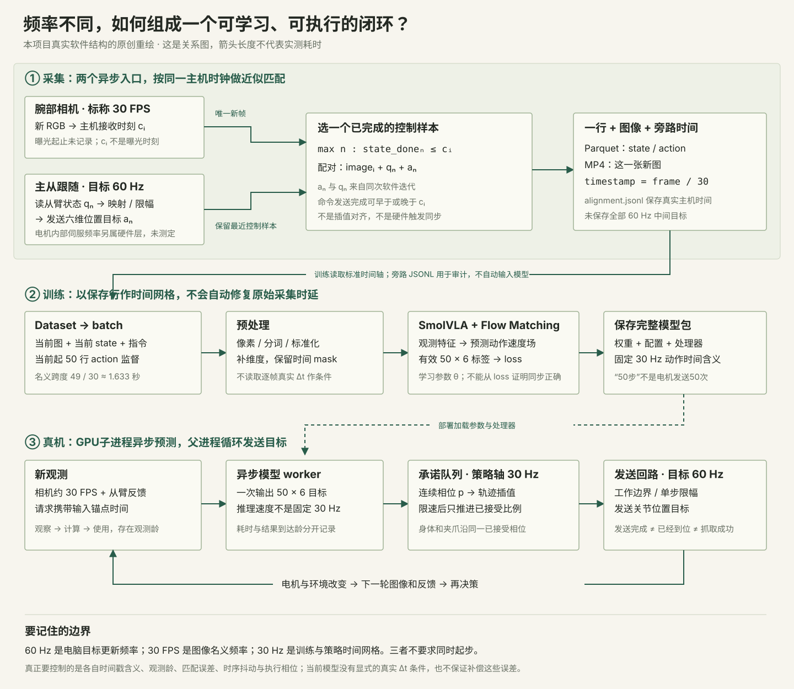
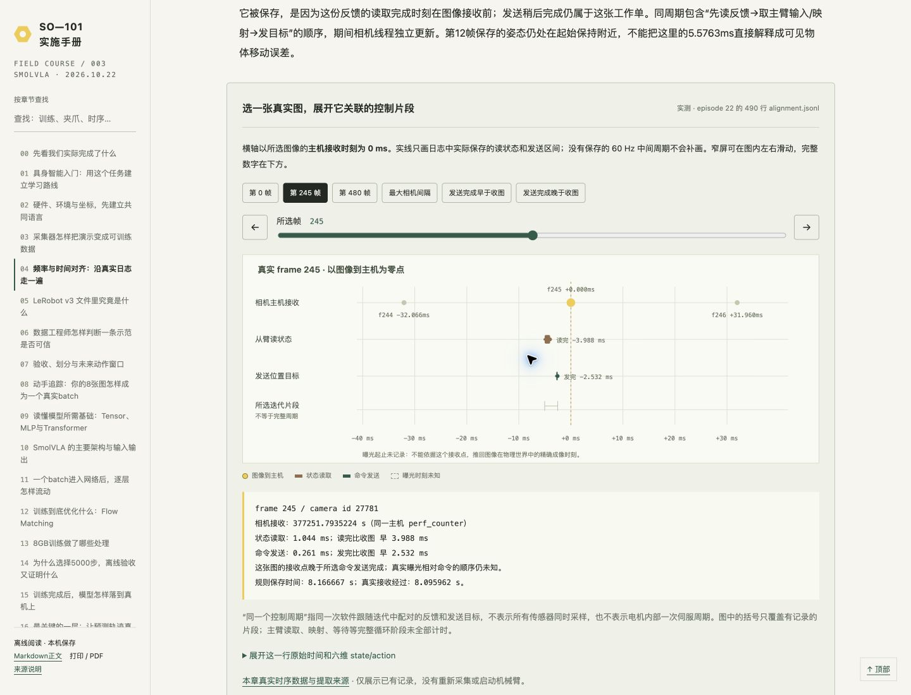
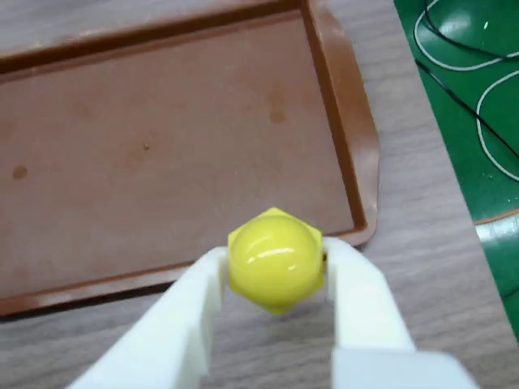
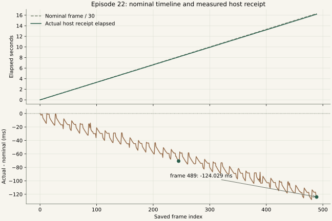
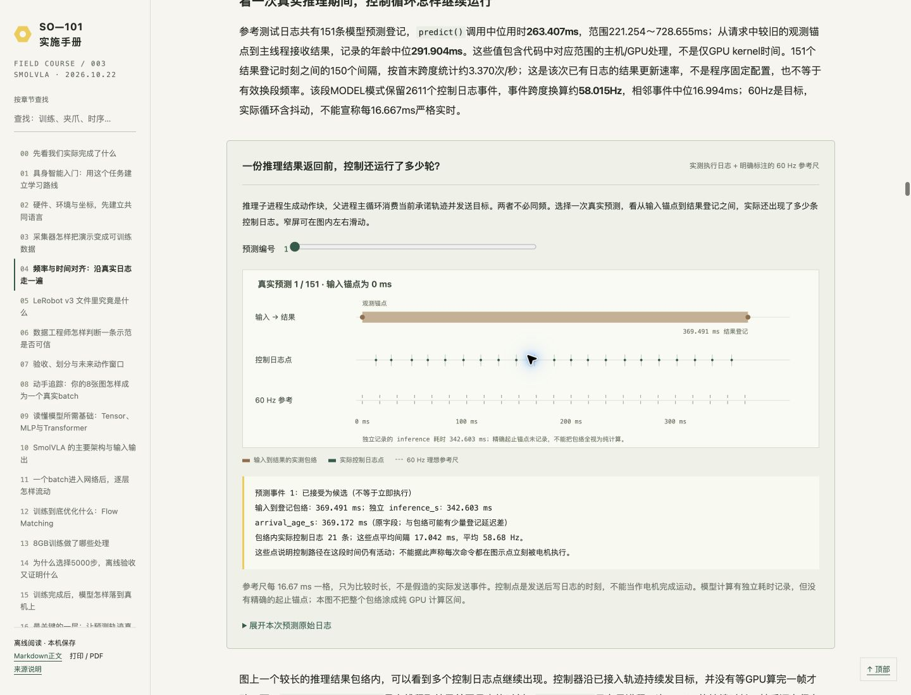

<a name="timing"></a>

# 04｜频率与时间对齐：沿真实日志走一遍

[教程目录](../README.md) · [上一章](03-capture.md) · [下一章](05-format.md)

> **学习目标：沿真实时间轴追踪一帧**
>
> 区分控制周期、曝光、主机接收、标称训练节拍与受限执行进度。

本章实测数据来自2026-10-19正式采集的50条示范，以及2026-10-20的v7参考测试`step005000-20261020T094811`。2026-10-22只读提取已有记录，未启动硬件、相机、模型或训练。图中的实线/点取自日志；理想频率尺与系统关系图是明确标注的教学示意。



## 先给四条时间线命名

不要先问“统一成多少Hz”，先问“这条流在什么事件上打时间戳”。频率只说一秒大约多少次，时间戳才告诉我们哪一次和哪一次对应。

| 流 | 本项目节奏 | 一次事件代表什么 | 当前不能据此证明什么 |
|---|---|---|---|
| 主从控制 | 上位机目标60Hz，名义周期16.67ms | 读取反馈、映射/限幅、调用发送目标的一轮软件更新 | 电机内部伺服也为60Hz；每轮结束已到目标 |
| 相机图像 | 相机设置30FPS，名义间隔33.33ms | 主机获得经过读取/处理的一张RGB图及其接收时间 | 那个时间就是曝光时刻；图像与关节同时测量 |
| LeRobot保存 | 每个被控制线程看到且尚未保存的新相机frame ID形成一行，数据/视频标称30FPS | 该图像加上按规则选出的一个控制样本 | 每个真实图像间隔都恰为33.33ms；完整保存了60Hz原始控制流 |
| 模型及执行 | 模型异步产生50×6动作块；动作节点标称30步/秒；上位机发送目标60Hz | GPU预测和轨迹发送是两个独立节奏 | GPU每秒推理30次或60次；网络会自动识别相机延迟 |

“电机的Hz”还需再分层：这里确认的是电脑向从臂发送目标的更新频率，电机驱动内部位置/速度/电流调节循环未在本项目测定。不要把日志中的60Hz打印值标成电机固件控制频率。[采集频率配置](../code/project/record-so101.py#L31) · [部署发送循环](../code/project/test-yellow-smolvla-robot.py#L303)

<a name="timing-cycle"></a>

## “同一个控制周期”怎样定义
把第c次`teleop_loop`迭代想成一张带附件的工作单：先获得用于本轮决策的反馈，再根据主臂和映射/限幅计算目标，随后发送。官方循环按`loop_start→读从臂反馈→读主臂→映射/限幅→发送→补足周期休眠`运行；[完整循环源码](../code/lerobot/lerobot_teleoperate.py#L187)明确了这个顺序。发送调用后建立一个`control_sample`，把本轮使用的反馈、各阶段目标和发送返回值放在一起。在现有侧车中没有独立的硬件cycle ID；“同周期”主要指一次软件迭代里这个样本的逻辑归属关系。相邻发送完成时刻可用来统计循环更新间隔，但并不等于精确持久化了迭代起点和睡眠边界；`state_read_started`也不能直接改名为`cycle_start`。

```python
# 与项目包装器一致的概念化伪代码；不是新增控制代码
state_read_start = perf_counter()
state = follower.get_observation()
state_read_end = perf_counter()

target = map_and_limit(leader_action, state)
send_start = perf_counter()
sent_target = follower.send_action(target)
send_end = perf_counter()

control_sample = {
    "observation": state,
    "observation_started": state_read_start,
    "observation_time": state_read_end,
    "sent_action": sent_target,
    "action_started": send_start,
    "action_time": send_end,
}
```

实际程序会复用本轮已读取的反馈，过旧时在发送前刷新并重算映射。上面强调数据关系，没有声称所有调用都在同一时刻完成。[反馈缓存及刷新](../code/project/record-so101.py#L816) · [形成control_sample](../code/project/record-so101.py#L839)

这几个时间的意义很具体：

- `state_read_started`到`state_observation`是一次**主机读取调用的时间窗口**。保存的state用读取完成时间作代表，不代表全部关节正好在完成那一微秒同时测量。我们没有每个电机内部测量时刻。
- `action_send_started`到`sent_action`是一次**主机发送调用的时间窗口**。后者说明发送函数返回；不是目标开始产生机械作用或运动完成的时间。实际到达需要后续反馈判断。
- `sent_action`中的数值是限幅后、从臂坐标中的位置目标；state是反馈。两者的差不能全部归因于时间错位，它还包括追踪误差、动力学、接触和限幅。
- 一个30FPS保存行不是一个60Hz控制周期本身。它引用某个周期的工作单；另一个中间周期可能只实际执行了，没有成为训练行。

你看到相机和机械臂的“action启动时间”不同，需要先辨认列名：图像有接收事件，机械臂有反馈读取及目标发送事件。当前文件没有可直接观测的“该动作真实物理启动瞬间”。不能把发送开始、发送结束、图像接收和电机运动开始写成同一类时间。

## 独立启动没有关系，错误配对才有关系

[实际相机读取线程](../code/lerobot/camera_opencv.py#L470)先读取硬件图像，再进行颜色/图像后处理，随后调用`perf_counter()`赋给`latest_timestamp`；所以代码变量即使叫`capture_time`也不代表曝光时间。相机可先于控制线程启动，正式录制也晚于它们启动；不需要让每个设备从同一个0秒开始。相机在自己的线程中持续产生图像，没有等待每个action触发曝光；action是连续更新的位置目标，也不是一条单独的“拍照后抓一下”命令。当前采集用同一Windows进程的主机单调时钟表达相关事件，用录制开始边界排除之前的帧/反馈，再按时间选样。本地`perf_counter`秒数只应在这个共同运行上下文中相减；不能把另一台电脑、另一次开机或视频`frame_index/30`直接拿来相减。

采集匹配规则是：对每张被控制线程看到的新图，从控制样本环形缓冲区倒序找出**读取完成时间不晚于图像接收时间的最近一个反馈样本**，并取同一工作单里的发送目标。

```python
def select_control_sample(samples, camera_receive):
    for s in reversed(samples):
        if s["observation_time"] <= camera_receive:
            # 实际程序还检查过旧/过迟，超过0.1秒会报错
            return s
```

这里的`latest preceding`修饰**反馈读取完成时间**，不保证发送结束也在图像接收前。因为反馈和发送是两个先后事件，相机线程可以在它们之间收到一张图。此时“这张图+该反馈+该目标”仍符合当前规则；它表达的是基于邻近反馈作出的目标，而非三路同时曝光/采样。[真正的选择函数](../code/project/record-so101.py#L154)

下面直接代入**episode22第12帧的实测值**，把这张图的主机接收时刻设成0ms，保留原始相对间隔：

```text
读取反馈    −1.4451 ── −0.4050 ms
图像接收                   0 ms       ← 真实曝光时刻未知
发送目标                        +5.3225 ── +5.5763 ms
```

它被保存，是因为这份反馈的读取完成时刻在图像接收前；发送稍后完成仍属于这张工作单。同周期包含“先读反馈→取主臂输入/映射→发目标”的顺序，期间相机线程独立更新。第12帧保存的姿态仍处在起始保持附近，不能把这里的5.5763ms直接解释成可见物体移动误差。

### 真实配对实例：以该图主机接收时刻为0



| frame | state读取完成−收图 | 目标发送完成−收图 | state读取调用用时 | 目标发送调用用时 |
| --- | --- | --- | --- | --- |
| 0 | -6.2892 ms | -4.6280 ms | 1.0666 ms | 0.3902 ms |
| 12 | -0.4050 ms | +5.5763 ms | 1.0401 ms | 0.2538 ms |
| 245 | -3.9878 ms | -2.5315 ms | 1.0436 ms | 0.2614 ms |
| 480 | -4.9755 ms | -3.6624 ms | 0.9932 ms | 0.2870 ms |

负值表示该主机事件早于图像接收，正值表示晚于。frame12发送完成晚于收图约5.5763ms，仍符合“以最近在先state选择控制样本，再取同周期action”的规则。state读取、发送完成、相机接收都是主机侧事件，不能当作曝光、硬件测量或电机生效时刻。这里只保留随图像选中的控制片段，未补造中间60Hz周期。

[真实490行与全量统计](../assets/timing-real.json) · [配对函数](../code/project/record-so101.py#L154)

[全部490帧可选时间轴下载](https://github.com/damonwangk/so101-yellow-nut-smolvla/releases/download/tutorial-v1.0/so101-smolvla-tutorial-offline.zip)：解压后打开 `开始阅读.html`。本页提供可直接在 GitHub 阅读的静态实例，离线包保留全部滑块、逐帧选择与动画。

时间轴可切到245帧、480帧、当前条最大间隔及发送在图像前/后的实例。只画**已随图像保存的控制样本**，没有填造未持久化的中间60Hz周期。图中编号是保存frame_index，并不是全控制流cycle ID；33ms左右两条保存行之间，机械臂通常还实际运行过其他控制周期。

正负号十分重要。现有侧车的`camera_to_state_ms = state_end − camera_receive`，正常应≤0；`camera_to_action_ms = send_end − camera_receive`允许正负。后者正值不等于一定错位或错误使用未来图像；它反映的是这次目标发送比图像接收晚了多少。现有100ms检查是程序拒绝明显过旧/过迟样本的界限，不能宣传为“同步精度100ms”，更不能用它保证任务接触精度。[字段及公式](../code/project/record-so101.py#L214)

再注意两个容易漏掉的等待：图像接收后，控制线程何时查看它会受排程影响；写盘线程还会更晚才`add_frame`。文件落盘或日志写入的时间不是观测发生时间。sidecar特意保留来源事件时间，供离线计算，而不拿写盘时刻伪装成采样时刻。

## 从29570行看偏差，而不是只看平均FPS

以下统计覆盖50条的全部29570个保存行；相机相邻间隔共29520个，分别在各episode内计算，没有把复位间隔混进去。P99表示该统计量约99%的值不超过该数，不能解释为任务成功率。

| 实测量 | 中位数 | P99 | 最大值/范围 |
|---|---:|---:|---:|
| 相机相邻主机接收间隔 | 32.085ms | 50.010ms | 78.561ms |
| 图像接收时，所选state读取完成已过去多久 | 8.258ms | 16.606ms | 55.944ms |
| 发送完成−图像接收（有符号） | −6.581ms | +1.398ms | −54.626～+28.063ms |
| state读取调用用时 | 1.116ms | 1.503ms | 3.230ms |
| action发送调用用时 | 0.217ms | 0.416ms | 2.054ms |

所有保存行均满足state读取完成不晚于图像主机接收；3233/29570行（约10.93%）发送完成在图像接收之后。这个比例说明异步事件确实会穿插，不代表10.93%的标签错误，也不证明其任务影响为零。state age和camera_to_action不是曝光延迟；全局最长78.561ms是**相邻图像到达间隔**，也不是图像相对关节的同步误差。

各条相机实测30.117～30.260FPS，控制59.752～59.948Hz。相机读取序号累计跳过18帧，日志仍保留这一事实。代码100ms检查只是拒绝明显过旧/过迟样本的界限；本次实际分布与阈值是两件事。[查看本次只读时间证据JSON](../assets/timing-real.json) · [提取脚本全文](../code/project/explain_saved_timing.py#L1)

## 用你自己的数据理解“同一行不等于相同角度”

你已经看过的真实训练episode22，frame245，名义时间为`245/30≈8.1667s`，全局index15342。下图来自这张真实腕部图，时间与状态/action均能追到同一保存行。



| 第245帧来源事件 | 原始主机perf_counter秒数 | 相对该图主机接收时刻 |
|---|---:|---:|
| state读取开始 | 377251.7884910 | −5.0314ms |
| state读取完成 | 377251.7895346 | −3.9878ms |
| action发送开始 | 377251.7907295 | −2.7929ms |
| action发送完成 | 377251.7909909 | −2.5315ms |
| 相机读取/后处理后的接收 | 377251.7935224 | 0ms |
| 写入线程登记episode_frame事件 | 377251.8238236 | +30.3012ms |

最后一行已经晚了约30ms。它包含排队/写入线程处理等开销，不能被当成相机拍摄、状态采样、目标生效或最终磁盘提交时刻。真正用于配对的仍是前五项来源事件。绝对perf_counter值没有日历意义，只在共享主机运行上下文中计算差值；[Python时钟说明](https://docs.python.org/3.11/library/time.html#time.perf_counter)也要求使用两次调用的差值。

官方reader实际读取的同一行中：

```python
state = [2.989011, -38.417583, -17.362637,
         53.978024, -1.362637, 35.122700]
action0 = [3.032967, -38.681320, -21.494505,
           54.065933, -1.450549, 33.122700]
# action窗口下一行目标，即frame246：
action1 = [3.032967, -37.802197, -22.285715,
           54.065933, -1.450549, 33.122700]
```

这来自`batch-real.json`中的真实读取结果，不是虚构关节曲线。以肘部为例，反馈−17.362637°，当前目标−21.494505°，差约−4.131868°；这不表示“图像和动作差4.13秒”，也不能仅凭差值估算相机延迟。模型的题目正是：从图像和当前关节状态，预测本行及后续行应该发送的目标。各原始事件的真实主机间隔，必须另外查`alignment.jsonl`，不能从角度差倒推出时间。

## 为什么要保存两套时间，训练到底用哪一套

当前采集有三层：

```text
原始事件：不规则的图像主机接收时间、state读取窗口、action发送窗口
    ↓ 以图像为锚点，选最近的在先state及其同周期action
训练行：image_i + state_i + action_i
    ↓ 保留行序，不做连续时间插值重采样
规则时间：timestamp_i = i / 30；MP4也按30FPS编码

alignment.jsonl：另存真实主机时间、间隔、漂移、跳帧信息，用于审计
```

当前所做的是**配对与名义规则时间编码**，不是把真实事件精确重采样到均匀30Hz的完整信号处理。即使一小段真实接收间隔变为约79ms，下一保存行在训练时间轴仍只前进33.33ms；那段实际运动会被名义时间压缩。反之真实帧平均稍快，规则编码会轻微拉长。是否严重取决于异常有多大、是否集中在抓取/松开等关键阶段，以及运动速度。保留sidecar让这些问题可量化，但文件存在并不代表训练已使用它补偿。

60Hz循环也不是每两轮机械地抽一次：它每轮查看最新frame ID，只有ID变化才提交。相机和控制频率有抖动，所以被选中的控制周期间隔不必恒为2。如果控制线程来不及查看，中间相机帧可能被“最新帧”覆盖；`reader_frames_skipped_since_previous_sample`记录的是这里可见的消费者frame ID跳跃，不等于硬件传感器内部所有丢帧的完整计数。[新帧判定](../code/project/record-so101.py#L883) · [保存时间字段](../code/project/record-so101.py#L208)

## 在图上对照标称时间与真实接收时间

episode22首帧到frame245的相机主机接收跨度是**8.0959623秒**，规则时间轴却是**8.1666667秒**，两者相差−70.7044ms。到末帧489，真实接收跨度16.1759711秒，对应名义16.3000000秒，差−124.0289ms。这个累计差来自“以首图为共同0点后，实际到帧节奏与规则30FPS轴的差”，不能把它整体叫作相机固定延迟。

### 两根时间尺：规则30FPS与真实相机接收



| frame | 名义frame/30 | 相对首图实际经过 | 实际−名义 | 与上一保存图间隔 |
| --- | --- | --- | --- | --- |
| 0 | 0.000000 s | 0.000000 s | +0.000 ms | 无前帧 |
| 12 | 0.400000 s | 0.400241 s | +0.241 ms | 48.396 ms |
| 144 | 4.800000 s | 4.771245 s | -28.755 ms | 50.044 ms |
| 245 | 8.166667 s | 8.095962 s | -70.704 ms | 32.066 ms |
| 480 | 16.000000 s | 15.872050 s | -127.950 ms | 32.008 ms |
| 489 | 16.300000 s | 16.175971 s | -124.029 ms | 31.900 ms |

末帧相差约−124.029ms，是以首图为共同0点后两个时间轴的累计差，不是相机固定延迟。frame144前的实际间隔50.044ms，在训练索引中只占33.333ms；整条平均接收略快与局部长间隔可以同时出现。这里没有把数据严格重采样成均匀30Hz。

[490帧时间轴与累计偏差曲线下载](https://github.com/damonwangk/so101-yellow-nut-smolvla/releases/download/tutorial-v1.0/so101-smolvla-tutorial-offline.zip)：解压后打开 `开始阅读.html`。本页提供可直接在 GitHub 阅读的静态实例，离线包保留全部滑块、逐帧选择与动画。

离线交互包中可移动锚点，观察实际相邻图像间隔、固定33.333ms间隔与累计漂移。全数据最长间隔位于episode0的frame199→200：相机主机时刻375234.7540872→375234.8326478，实际经过78.5606ms，名义轴却只经过33.3333ms，reader序号289→291表明消费侧跳过1帧；不能据此还原那张未保存图。当前条最大间隔出现在frame143→144，真实间隔50.0442ms，模型行时间只前进33.3333ms。如果把同一段目标变化按名义时间执行，该局部时间关系就被压缩；这与全条平均接收稍快、规则编码略拉长可以同时存在。需要看局部与累计，不能只看一个平均FPS。

<a name="timing-model"></a>

## 模型没有一只隐藏的“自动对时钟”
以刚才frame245为锚点，配置指定观测偏移`[0]`、动作偏移`[0,1,…,49]`。reader把偏移解释为名义30FPS的索引窗口，取frame245到294的50行目标；视频按行`timestamp`解码当前图像。**这里不读取sidecar的真实主机接收、读取与发送时间。**[配置](../code/lerobot/configuration_smolvla.py#L149) · [索引窗口](../code/lerobot/dataset_reader.py#L215) · [解码入口](../code/lerobot/dataset_reader.py#L312)

```python
# 一个样本的概念输入输出；真实batch细节见“真实batch”章节
anchor = 245
sample = {
  "image": decode_video(timestamp=anchor/30),  # 当下1帧RGB
  "state": rows[anchor]["state"],             # 原始行[6]，reader按[0]堆成[1,6]
  "actions": rows[245:295]["action"],         # [50,6]
  "task": "Pick up the yellow nut and place it into the brown tray."
}
# DataLoader堆8个锚点，再归一化、分词，进入模型：
# 图像 [8,3,480,640] → [8,3,512,512]
# state [8,1,6] → 取当前state → [8,32]
# action [8,50,6] → [8,50,32]
```

把这个50步窗口里的几个真实位置列出来，更容易看见“模型索引”和“原始事件时间”的差别。下表全部以frame245为共同起点：

| k / 对应行 | 模型名义偏移 k/30 | 真实相机接收经过 | 真实目标发送完成经过 |
|---|---:|---:|---:|
| 0 / 245 | 0ms | 0ms | 0ms |
| 1 / 246 | 33.333ms | 31.960ms | 33.563ms |
| 15 / 260 | 500.000ms | 496.005ms | 483.997ms |
| 49 / 294 | 1633.333ms | 1632.615ms | 1635.200ms |

模型把第15个动作位置理解为名义0.5秒，而这个目标在原采集中的发送完成偏移约0.484秒。当前reader保持行序并取标签，没有依据这16.003ms差值移动标签、额外插值或把Δt附到action token。这个窗口首末累计误差很小，也不能证明每个中间节点都均匀。动作时间由程序的输出位置约定，不是给每个action额外附了一只真实时钟。

frame480到末尾只有10行有效动作；重复末行补成50步，并用`action_is_pad`排除后40项loss。这处理的是**episode边界**，不是补偿帧间抖动或相机延迟。[padding的计算](../code/lerobot/dataset_reader.py#L226)

模型当前真正用于条件计算的是图像、状态和任务tokens，监督是动作窗口。processor做归一化和分词，训练器把图像除255；它们都没有根据`camera_to_state_ms`对图像、state或动作窗口做动态偏移。即使batch字典里还保留名义timestamp列，当前SmolVLA前向也没有把它当成传感器延迟输入。[processor](../code/lerobot/processor_smolvla.py#L63) · [训练入口](../code/lerobot/lerobot_train.py#L603) · [模型取输入](../code/lerobot/modeling_smolvla.py#L294)

这也说明100ms相机配对门槛、约0.3秒推理结果年龄和动作节点33.33ms属于不同统计，不能混成同一个延迟指标。

“模型会学到固定延迟”最多是一个可能性：如果训练与测试都有小而稳定的偏差，预测可能在这种数据关系下表现良好；这不是显式延迟辨识，也不能保证换相机缓冲、加快动作或改变接触条件后仍成立。本次`n_obs_steps=1`，没有输入多帧视觉历史来直接观察运动速度；未来动作块也不能凭空找回被删掉的中间60Hz目标。

还要把Flow Matching的`t`从真实时间中解救出来：`x_t=t·noise+(1−t)·action`中的t是噪声插值程度。它不是episode第几秒、图像接收时间、GPU耗时或每个关节的生效时刻。10轮Euler积分改变的是整块50步动作的数值；50步的实际时间展开由外部执行器负责。[Flow Matching计算](../code/lerobot/modeling_smolvla.py#L689)

<a name="timing-online"></a>

## 推理时的配对与采集并不完全一样
部署父进程每轮读取当前从臂反馈，另取相机最新frame；不等待相机恰好在反馈读取结束后产出新图。没有请求正在计算且图像接收年龄<0.1秒时，把两者送入推理队列：

```python
image, camera_received = latest_camera_frame()
state, state_read_end = current_follower_observation()
request = {
    "image": image,
    "state": state,
    "observed_at": min(state_read_end, camera_received),
    "request_progress": action_queue.progress,
}
```

这是解释结构的伪代码，实际父进程先读state，再取latest image。`min(...)`只使age检查从较旧的一路算起，**不会把新的state插值回图像时间**，不会更改图像，也不会完成两个传感器同步。部署没有采集那样的state历史回溯选样，因此两边存在配对规则差异。部署也没有按camera frame ID强制每个请求都用不同帧：若预测很快而相机尚未更新，在年龄阈值内可能再次使用同一图像配更新state。当前主循环不会按30FPS等待一次再推理。[实际请求代码](../code/project/test-yellow-smolvla-robot.py#L217) · [最新帧与请求](../code/project/test-yellow-smolvla-robot.py#L259)

推理耗时`inference_s`测的是子进程`predict()`用时；从观测到使用的总延迟还包括图像在主机中已有的年龄、请求传递/排程、结果传递、等待段接入等。`1/inference_s`只能描述单次计算吞吐的近似上限，不能直接标成实际视觉闭环频率。日志中的prediction age把多个环节合起来供排查。[耗时记录](../code/project/test-yellow-smolvla-robot.py#L89)

## 看一次真实推理期间，控制循环怎样继续运行

参考测试日志共有151条模型预测登记，`predict()`调用中位用时**263.407ms**，范围221.254～728.655ms；从请求中较旧的观测锚点到主线程接收结果，记录的年龄中位**291.904ms**。这些值包含代码中对应范围的主机/GPU处理，不是仅GPU kernel时间。151个结果登记时刻之间的150个间隔，按首末跨度统计约3.370次/秒；这是该次已有日志的结果更新速率，不是程序固定配置，也不等于有效换段频率。该段MODEL模式保留2611个控制日志事件，事件跨度换算约**58.015Hz**，相邻事件中位16.994ms；60Hz是目标，实际循环含抖动，不能宣称每16.667ms严格实时。

### 实测：模型返回之前，控制循环仍持续发送



| 预测编号 | 输入锚点→结果登记包络 | 独立predict调用耗时 | 原arrival_age | 包络内控制日志数 |
| --- | --- | --- | --- | --- |
| 1 | 369.491 ms | 342.603 ms | 369.172 ms | 21 |
| 151 | 274.089 ms | 263.456 ms | 273.771 ms | 16 |

该次已有日志包含151个预测结果；MODEL模式2611个控制日志事件，按首末事件跨度约58.015Hz。60Hz是上位机目标，不是严格硬实时承诺；predict调用中位耗时263.407ms。

`prediction.monotonic`是父进程取结果后登记日志的时刻；`inference_s`是子进程predict调用的持续时长，之后还有输入JPEG保存、IPC和排程。不能用登记时刻减耗时反推精确GPU起点。`accepted=true`表示接受为候选，不等于立即执行；当前承诺段完成后才换段。

[151次预测与控制点逐次对照下载](https://github.com/damonwangk/so101-yellow-nut-smolvla/releases/download/tutorial-v1.0/so101-smolvla-tutorial-offline.zip)：解压后打开 `开始阅读.html`。本页提供可直接在 GitHub 阅读的静态实例，离线包保留全部滑块、逐帧选择与动画。

图上一个较长的推理结果包络内，可以看到多个控制日志点继续出现。控制器沿已接入轨迹持续发目标，并没有等GPU算完一帧才动一下。`prediction.monotonic`是主线程取结果并写日志的时刻，`inference_s`只有子进程一次predict的持续时长；其后还有保存输入JPEG、IPC和排程。因此不能用“结果登记时刻−inference_s”倒推出精确GPU开始时间。图把包络和计算时长分开显示。日志的`accepted=true`只表示接纳为候选，仍可能被更新预测覆盖，不能当作每次预测已经立即执行。

## 已有执行器解决的是“策略进度接续”，不是传感器延迟

GPU返回50×6目标后，经反归一化回真实关节单位。50个节点索引0～49，首末节点相隔49/30≈1.633秒；按50个采样槽常简写为约1.67秒，软件还会插入前一发送目标作为接段锚点。实际执行时间还受延迟截段、过渡和限幅影响。轨迹节点保持训练的名义30步/秒，父进程目标60Hz在节点之间线性插值：正常一轮最多前进`30×1/60=0.5`个策略间隔。身体限速只接受α时，进度也只增加α倍，夹爪取相同接受进度；它可以整体慢下来，不会因墙钟时间走了就强行跳过身体尚未完成的目标。

新预测携带请求时的`request_progress`。接入时用“现在已接受的进度−请求时进度”确定应跳过的预测前段，而不是用“GPU耗时×30”盲目跳步。当前默认承诺完整剩余段，等待旧段接完才接入，保留最后第49目标；所以**频繁获得新预测不等于每次立刻视觉纠正当前轨迹**。软件目标的进度也不等于机器人无误差地完成了物理任务，尤其夹爪没有接触/力反馈。[进度接续](../code/project/yellow_action_queue.py#L39) · [60Hz插值和限速进度](../code/project/yellow_action_queue.py#L80)

这套机制纠正了此前限速后身体与夹爪时间错开、旧15帧重规划截断末段的问题。它没有改写训练标签、估计曝光延迟或补偿图像/state的时间差；当前`rtc_config=null`，未启用官方RTC去噪指导。网页应把“轨迹接续已实现”和“传感器同步仍是近似”画成两个不同问题。

<a name="timing-effects"></a>

## 这些偏差会影响抓取吗？要看偏差发生在什么阶段
若物体与机器人在短时内近似匀速，时间差Δt造成的几何不一致可粗略估为`位置误差≈速度×Δt`。例如**教学假设**：夹爪相对物体移动100mm/s，延迟20ms，就可能相差约2mm；关节转速15°/s，20ms对应0.3°。这是数量级示意，不能据此宣称本机械臂末端误差实测为2mm；需要运动学、相机标定和真实延迟测量才能换算本机误差。

接触过程更敏感：夹爪碰到螺母后螺母会滑动，下一刻图像和动力学都变了。“延迟小一点，角度差小一点”的线性想法在碰撞、滑移和脱手瞬间可能失效。较旧图像配新state可能让网络同时看到“螺母还在那里”和“手已经到了另一处”；训练的动作标签若有抖动，监督也可能把同类视觉条件关联到不同阶段动作。因此应重点看接近、闭爪、抬起、到盘、松开五个阶段，而不只看整条平均频率。

| 现有证据 | 可以下的结论 | 仍未知或本次没有实现 |
|---|---|---|
| 配对条件、四个主机事件字段、原始sidecar | 可核算主机侧读取/发送相对图像接收的偏差 | 硬件曝光时刻、每关节测量时刻、目标物理生效时刻 |
| 保存行序、30FPS timestamp、视频帧数 | 可追踪模型看到第几行、预测哪50行 | 严格均匀30Hz的真实世界采样；中间60Hz完整原始目标 |
| 训练processor与forward源码 | 模型按该配对约定学图像/state→动作窗口 | 显式lag输入、对时、延迟辨识或自动补偿 |
| v7已接受策略进度与发送日志 | 发送目标按共同进度接续、身体限速不会单独让夹爪抢跑 | 每个目标物理完成；捏持力足够；所有放置条件泛化 |

对下一轮工程改进，应先量化各阶段偏差和长间隔，再决定是否需要改变链路：保存独立60Hz控制原始流和更完整相机序号；给读取/写入关联显式cycle ID；确认曝光或设备时钟；在副本上选择并记录重采样策略；让部署复用与训练一致的图像锚点选state规则。若能取得测量证据，再考虑固定lag标定、状态插值或历史观测。这些是后续方案，**本次只更新教程和离线可视化，没有改采集、训练或控制程序**。

<details class="self-check"><summary>自测：action_send比camera_receive晚4ms，就能判为错误数据吗？</summary>

不能。先看选择规则和时间字段：本项目以state读取完成时间选择周期，该周期发送结束可以稍后。4ms需要结合读取窗口、运动阶段、分布与一致性判断；它不代表电机物理晚4ms启动。当前模型没有显式读取这4ms并补偿。

</details>

---

**停一下，用自己的话回答：** 进入SmolVLA后，归一化和Flow Matching会自动消除相机与动作的时间差吗？

<details>
<summary>参考答案</summary>

不会。当前模型没有读取逐帧主机时间差，未来动作按标称30FPS索引；数据关联和执行器时序只能处理各自负责的部分，曝光延迟与电机响应仍未测定。

</details>

[教程目录](../README.md) · [上一章](03-capture.md) · [下一章](05-format.md)
