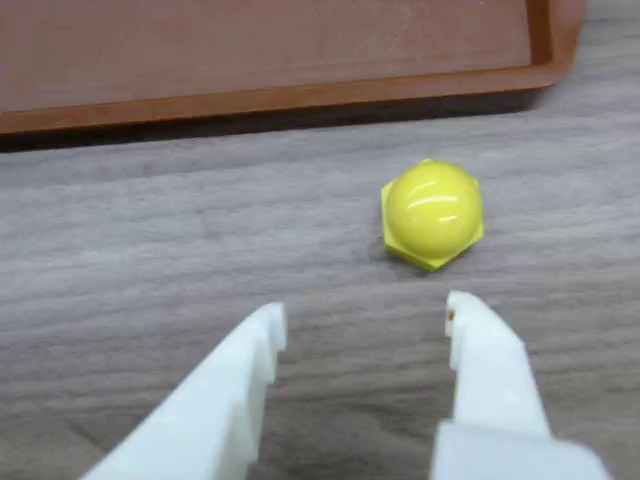
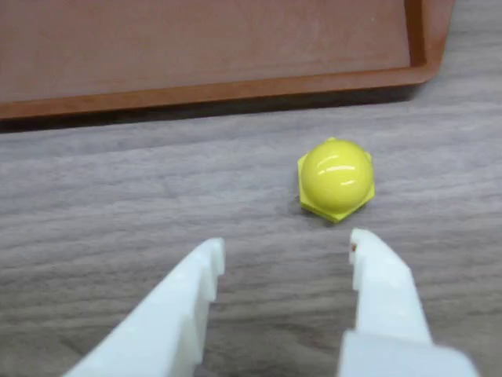
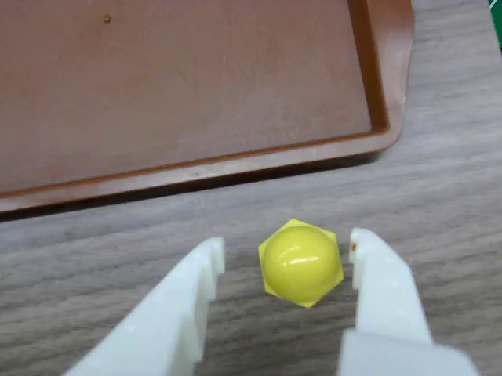
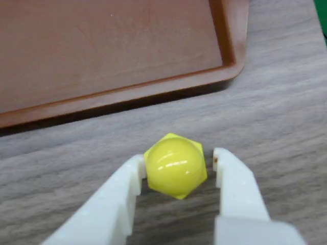
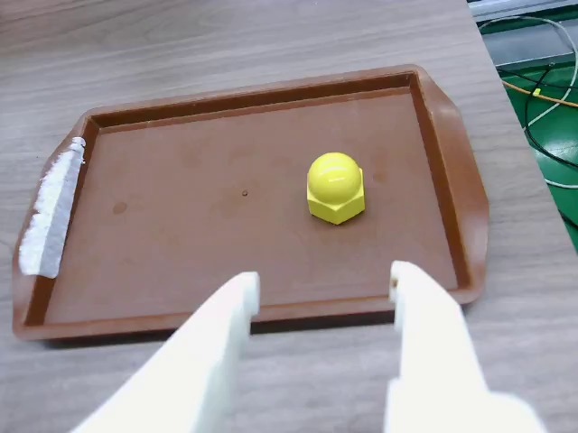
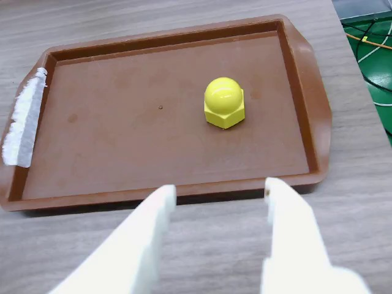
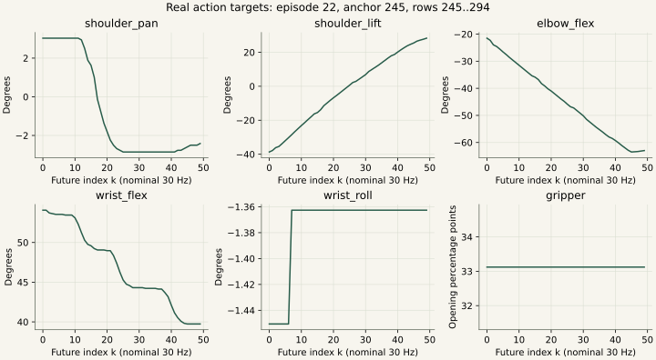

<a name="batch-lab"></a>

# 08｜动手追踪：你的8张图怎样成为一个真实batch

[教程目录](../README.md) · [上一章](07-dataset.md) · [下一章](09-foundations.md)

> **学习目标：亲手索引真实batch**
>
> 能用b、k、j找到一张图、一条状态和一个动作目标。

## 先认识“一个训练样本”：它不是一整条视频

先看你自己的数据，而不是从抽象的张量定义开始。训练 episode 22 一共有 490 帧，名义采样率为 30 FPS。第 0 帧的腕部画面里，黄色螺母放在桌上，夹爪张开；第 245 帧已经能看到黄色物体被夹住，棕色盘位于画面上方。这两张图来自官方 LeRobot reader 对本 episode 视频的实际解码，分别对应同一行中的状态和动作，不是拿成功演示视频配出的示意图。


**一个训练样本是“现在看到了什么、现在机械臂在哪里、任务是什么，以及接下来该怎么动”。** 这里的“现在”叫锚点。以 episode 22 第 245 帧为锚点，样本包含：

| 内容 | 真实来源 | 这个样本里的形状 |
|---|---|---|
| 当前腕部图像 | MP4 中 245/30 秒附近、由 reader 按时间戳解码匹配的 RGB 帧 | `[3,480,640]`，`uint8` |
| 当前从臂状态 | Parquet 第245帧的 `observation.state` | `[1,6]`，`float32` |
| 未来动作目标 | 本 episode 第245至294帧的 `action` | `[50,6]`，`float32` |
| 动作是否越出 episode | reader 根据锚点和窗口算出 | `[50]`，`bool`，这里全为 False |
| 文字任务 | `task_index=0` 查询任务表 | 一个字符串 |

`action[0]` 是锚点时刻的记录目标，后面是 `+1/30`、`+2/30`……`+49/30` 秒的目标。因此通常把它叫未来动作窗口，但窗口包含当前时刻；第一项到最后一项的时间跨度为 `49/30≈1.633` 秒。50个目标按30Hz逐个执行覆盖约1.667秒的控制槽位，不要把这两种说法混为一谈。

当前配置 `n_obs_steps=1`，所以训练时只看一个当前图像，不把490帧整段视频输入模型；模型名字里的 Video-Instruct 也不代表这次微调就输入了视频序列。MP4 是节省空间的存储容器，数据加载器从中解码本次需要的帧。**存储单位是 episode，采样单位是锚点，模型监督单位是一个动作窗口。**

### 8个真实采样点，不是8张未来预测图

| 样本 | 样本 | 样本 | 样本 |
| --- | --- | --- | --- |
| <br>b=0, frame=0 | <br>b=1, frame=30 | <br>b=2, frame=60 | <br>b=3, frame=120 |
| <br>b=4, frame=180 | <br>b=5, frame=245 | <br>b=6, frame=440 | <br>b=7, frame=480 |



它们是为教学固定选择的8个锚点，来自同一真实episode；不是历史训练随机batch的抽样顺序。

```python
# Dataset读取单个锚点；default_collate在最前面堆叠8个样本
image = batch['observation.images.wrist_camera']
state = batch['observation.state']
image.shape = (8, 3, 480, 640)    # uint8 RGB
state.shape = (8, 1, 6)          # float32，一个观察时刻
action.shape = (8, 50, 6)        # 每个锚点当前起50步目标
action_is_pad.shape = (8, 50)    # bool

# trainer像素除255、processor标准化/分词后，模型prepare helpers：
images[0].shape = (8, 3, 512, 512)
state.shape = (8, 32)
action.shape = (8, 50, 32)
text_tokens.shape = (8, 48)      # 本指令14个有效token + 34个padding
```

```text
batch['observation.state'][0,0,:] = [-5.274725, -77.098900, -0.483516, 87.560440, -1.890110, 52.147240]
batch['action'][0,0,:] = [-5.406593, -77.802200, 0.043956, 87.824173, -1.538462, 52.459015]
normalized_state[0,:6] = [-0.167094, -1.258877, 0.943673, 1.577536, -0.584096, 0.456570]
normalized_action[0,0,:6] = [-0.205828, -1.270252, 0.984187, 1.597210, -0.142659, 0.472842]
```

frame480的50×6窗口只有10×6个有效标量；其余7个锚点各50×6有效，合计2160个有效监督标量。

| 索引例 | 实际源frame | shoulder_pan目标 | 是否padding |
| --- | --- | --- | --- |
| b=7,k=0,j=0 | 480 | -3.384615 | False |
| b=7,k=9,j=0 | 489 | -3.472528 | False |
| b=7,k=10,j=0 | 489 | -3.472528 | True |
| b=7,k=49,j=0 | 489 | -3.472528 | True |

[完整原始数值与50×6动作](../assets/batch-real.json) · [打印实际读取/预处理输入输出的脚本](../code/project/explain_real_batch.py)

[8样本、阶段、关节和未来步可选版本下载](https://github.com/damonwangk/so101-yellow-nut-smolvla/releases/download/tutorial-v1.0/so101-smolvla-tutorial-offline.zip)：解压后打开 `开始阅读.html`。本页提供可直接在 GitHub 阅读的静态实例，离线包保留全部滑块、逐帧选择与动画。

## 第一步：把磁盘上的文件关联起来

每条示范包含视频和数值表。LeRobot v3 的元数据负责说明“第22条在哪里、从哪一帧开始、视频时间偏移是多少、每列是什么意思”。加载器做的事可以写成：

```text
data/*.parquet 当前行
  ├─ episode_index=22, frame_index=245, timestamp≈8.166667
  ├─ observation.state：实际读回的从臂关节状态
  ├─ action：实际送给从臂的目标
  └─ task_index=0 ──查 meta/tasks.parquet──> 任务字符串

meta/episodes：把episode22映射到视频文件和视频起始时间
  └─ videos/...mp4 ──解码当前时间附近的对应帧──> RGB图像
```

第0帧的 `frame_index=0`，但全数据集唯一的 `index=15097`。第0帧不是数据集第0行，而是第22个 episode 内的第0帧。选过 episode 子集之后，`dataset[0]` 又指子集内的第一行。区分这三种索引，是排查错配和边界错误的第一步。

本项目的动作是五个关节的**从臂目标角度**和夹爪的**归一化活动范围目标**，不是物体三维坐标、不是速度、不是关节增量，也不是抓力：

```python
joint_order = [
    "shoulder_pan", "shoulder_lift", "elbow_flex",
    "wrist_flex", "wrist_roll", "gripper",
]
# 前五维：degree；最后一维：percentage point
```

同一维上 state 和 action 不相等很正常：前者是测量反馈，后者是控制目标。机械臂有动力学延迟，也可能受到接触约束。把两列混用，会把“应该发什么控制指令”变成“过去测到了什么位置”。

## 第二步：让官方 Dataset 真正取出样本

下面是实际运行的只读脚本中的核心部分。`resolve_delta_timestamps` 使用本次保存的 SmolVLA 配置：观测偏移 `[0]`，动作偏移 `[0,1,...,49]`，再除以30换成秒。我们保留了训练 factory 的 `return_uint8=True`、`video_backend='pyav'`，没有在 Mac 安装训练环境。

```python
cfg = SmolVLAConfig.from_pretrained(checkpoint)  # 只读config，不加载权重
meta = LeRobotDatasetMetadata(repo_id, root=dataset_root)
deltas = resolve_delta_timestamps(cfg, meta)

dataset = LeRobotDataset(
    repo_id, root=dataset_root,
    episodes=[22],                  # 22属于45条训练episode
    delta_timestamps=deltas,
    video_backend="pyav",
    return_uint8=True,
    image_transforms=None,
)
sample = dataset[245]               # 当前子集只有episode22
print(sample["observation.state"].shape)           # torch.Size([1, 6])
print(sample["observation.images.wrist_camera"].shape)  # [3, 480, 640]
print(sample["action"].shape)                     # [50, 6]
```

为什么状态带一个长度为1的维度，而图像没有？factory 给所有 observation 指定了当前时刻 `[0]`；数值状态按索引堆叠，保留 `[T_obs=1,6]`。视频 reader 对只解码一个时刻的结果执行 `squeeze(0)`，图像成为 `[3,H,W]`。这来自实际代码，不能因为语义上“都只有一帧”，就给所有模态写同一种 shape。

`sample['observation.state']` 的真实输出（episode22，frame245）：

```text
[[  2.989011, -38.417583, -17.362637,
   53.978024,  -1.362637,  35.122700]]
```

`sample['action'][:3]` 的真实输出：

```text
[[  3.032967, -38.681320, -21.494505, 54.065933, -1.450549, 33.122700],
 [  3.032967, -37.802197, -22.285715, 54.065933, -1.450549, 33.122700],
 [  3.032967, -36.131866, -23.956043, 53.714287, -1.450549, 33.122700]]
```

先不要试图从这18个数“读懂抓取”。它们的意义要放回关节顺序、相机画面和时间窗口一起理解：从当前观测出发，专家接下来50次应该发送怎样的关节目标。图片给物体与盘子的外观关系，状态给机器人自身姿态，动作给示范者的未来控制序列。

## 第三步：8个样本怎样变成一个 batch

batch 的 B 是“这次同时算几个样本”。它与视频时长、机械臂数量和关节数量无关。我们从第22条训练 episode 固定取 `[0,30,60,120,180,245,440,480]` 八个锚点，为教学构造一个 batch。真实训练会通过训练集采样器打乱取样；**这不是声称恢复了某个历史训练 step 的原始 batch**，也不是把实际训练限制成只用这八帧。

```python
from torch.utils.data import DataLoader, Subset

anchors = [0, 30, 60, 120, 180, 245, 440, 480]
loader = DataLoader(
    Subset(dataset, anchors),
    batch_size=8, shuffle=False, num_workers=0,
)
batch = next(iter(loader))
```

默认 collate 相当于对每个同名字段做 `torch.stack`。字符串不能按数值叠，所以任务变成8个字符串的列表：

```text
8 × sample["observation.images.wrist_camera"] [3,480,640]
  ──stack──> batch["observation.images.wrist_camera"] [8,3,480,640]

8 × sample["observation.state"] [1,6]
  ──stack──> batch["observation.state"] [8,1,6]

8 × sample["action"] [50,6]
  ──stack──> batch["action"] [8,50,6]

8 × sample["action_is_pad"] [50]
  ──stack──> batch["action_is_pad"] [8,50]

8 × sample["task"] str
  ──collate──> batch["task"] list[str]，长度8
```

实际打印结果：

| 阶段 | 图像 | 状态 | 动作 | 文字 |
|---|---|---|---|---|
| Dataset 单样本 | `[3,480,640] uint8` | `[1,6] float32` | `[50,6] float32` | `str` |
| DataLoader | `[8,3,480,640] uint8` | `[8,1,6] float32` | `[8,50,6] float32` | `list[str]×8` |
| trainer 像素转换 | `[8,3,480,640] float32`，0到1 | 不变 | 不变 | 不变 |
| checkpoint preprocessor | 同上 | `[8,1,6]`，已标准化 | `[8,50,6]`，已标准化 | `[8,48] int64` tokens + mask |
| policy 的 prepare helper | `[8,3,512,512] float32`，−1到1 | `[8,32]` | `[8,50,32]` | 仍为 `[8,48]` |

其中 B=8；T_obs=1；T_action=50；C=3 是 RGB 通道；H/W 是图像高宽；6是机器人控制维数；32是通用模型内部预留宽度。512是预处理图像的H/W空间尺寸；720和960是神经网络特征宽度（hidden size）。空间分辨率、特征宽度与物理关节数是不同概念。

如果你看到 `[8,50,6]`，可以这样读：先选第几个训练样本，再选该样本未来第几个控制时刻，最后选哪个关节。`batch['action'][5,2,1]≈-36.131866`：第6个样本是锚点245，未来窗口第3项对应247帧，其 shoulder_lift 目标约−36.13°。

## 第四步：像素、关节数值和文字分别怎样预处理

三种模态使用不同变换，不能笼统说“归一化一下”。

**图像先由 trainer 做 `uint8→float32/255`。** 此步骤在 `preprocessor(batch)` 前发生，不是 `VISUAL:IDENTITY` 自动完成。本次 frame0 中心像素（y240、x320）真实 RGB 为 `[156,159,168]`，转换后是 `[0.6117647,0.6235294,0.6588235]`。随后 `prepare_images` 将640×480等比缩放到512×384，在上方补128行黑色，形成512×512；再做 `image*2−1`。黑色补边在模型输入中是 `[-1,-1,-1]`。这次实现使用上侧/左侧补边约定，不是中心补边。

```python
# 来自实际 trainer 的阶段顺序
for cam_key in dataset.meta.camera_keys:
    if batch[cam_key].dtype == torch.uint8:
        batch[cam_key] = batch[cam_key].float() / 255.0
batch = preprocessor(batch)
```

**state 和 action 用各自的训练集均值、标准差做 MEAN_STD。** 统计量来自45条训练 episode 的26,722帧，已保存在第5000步 checkpoint 的 normalizer 文件中。不能把验证集也拿来重算，更不能部署时根据当前一帧重新归一化。

```python
z_state  = (state  - mean_state)  / (std_state  + eps)
z_action = (action - mean_action) / (std_action + eps)
```

episode22 frame0 的 shoulder_pan 是−5.274725°。checkpoint 保存的该维 state mean≈−4.069637，std≈7.212027，所以结果约−0.167094。完整六维实际输出为：

```text
raw state:
[-5.274725, -77.098900, -0.483516, 87.560440, -1.890110, 52.147240]

normalized state:
[-0.167094, -1.258877, 0.943673, 1.577536, -0.584096, 0.456570]
```

标准化后超过±1很正常，因为 MEAN_STD 不把范围裁成 `[−1,1]`。如果按归一化数值判断“角度越界”，就混淆了模型空间与机械臂物理空间。

**任务字符串先补换行，再由保存的 tokenizer 切成 token ID。** 本任务不是一个字母一个token，也不是单词对应一个关节。实际输出为：

```text
input:
'Pick up the yellow nut and place it into the brown tray.\n'

valid token IDs，14个:
[31413, 614, 260, 5724, 2236, 284, 1379,
 357, 618, 260, 6354, 25477, 30, 198]

fixed length=48:
前14项为上述ID，后34项均为pad_token_id=2
attention_mask = [True]×14 + [False]×34

decode(valid IDs):
'Pick up the yellow nut and place it into the brown tray.\n'
```

token ID 只是词表索引；Embedding 层把索引查成模型能运算的向量。ID大不表示这个词更重要。本次8个样本任务相同，8行 token ID 相同；图像、关节状态与未来动作不同，仍然是8个不同的条件模仿学习样本。

## 第五步：三个不同的 padding，不要混在一起

**1. 动作时间补齐：** 在frame480取50步，episode却只有480…489这10个真实时刻。官方 reader 把超界索引夹到489，因此第10项到第49项会重复最后一帧动作，并标记 `action_is_pad=True`。它不跨到episode23，不发明未来数据，也不因为重复了数值就把它当成真实监督。

```text
requested frames: 480,481,...,489,490,491,...,529
actual rows:     480,481,...,489,489,489,...,489
action_is_pad:   F,  F, ..., F,  T,  T, ..., T
                 <---10---> <------40------>
```

注意：真正的frame489位于窗口下标9，其 mask 是 False；随后40个复制出来的frame489才是 True。不能仅凭动作数值是否相同区分padding，静止示范本来也可能有相同数值。

**2. 动作/状态维数补齐：** 机器人只有6维，模型支持最大32维，所以 `prepare_state` 取当前状态后在末尾补26个0；`prepare_action` 对每个未来时刻也补26个0。此时动作变成 `[8,50,32]`。这26维不是新电机、不是抓力、不是末端位姿。

**3. 文本长度补齐：** 14个有效 token 补成48个，文本 attention mask 决定哪些位置有效。这与50步动作是否越出 episode 是两种 mask。

为什么 mask 会影响训练？官方 SmolVLA 在计算 flow-matching 每元素误差后，先只保留本机器人真实6维，再用 `~action_is_pad` 去除超界时间，并按有效元素数归约：

```python
# 解释用简化写法；actual .forward 中按同样顺序处理
error = squared_velocity_error[..., :6]       # 排除虚拟动作维
valid = ~batch["action_is_pad"]              # [8,50]
loss = (error * valid[..., None]).sum()
loss = loss / (valid.sum() * 6).clamp_min(1)
```

这个教学 batch 的7个锚点各有50步有效目标，frame480只有10步：总有效步数为360，真实监督元素为 `360×6=2160`。如果直接对全部 `8×50×6=2400` 项求平均，padding会改变loss的尺度；如果不屏蔽重复项，还会让最后的静止动作被过度学习。

## 第六步：进入模型前，什么是条件，什么是答案

这里沿用保存时已建立的图像/state/action关联。batch里的名义timestamp不意味着模型读取了真实传感器延迟；[时间对齐章节](04-timing.md#timing-model)说明sidecar没有进入当前网络、归一化与padding也不负责校时。

到这里，图像、文字、状态是模型的条件；示范动作窗口是训练答案。训练过程会对动作窗口加噪，构建 flow-matching 的输入和目标速度，动作专家学习在条件约束下把噪声变成合理的未来动作。**不能把“训练时答案参与构造带噪输入”理解成“部署时把未来答案喂给模型”。** 真机部署没有 `batch['action']` 真值，也没有需要遮罩的已知未来；它用当前图像、当前状态和任务，从噪声生成动作序列。

这次只读教学运行停在 parameter-free 的 prepare helper：它调用了真实的 `prepare_images`、`prepare_state`、`prepare_action` 方法，但没有实例化策略网络、没有读取 `model.safetensors`、没有做神经网络 forward，也没有优化器更新。后续图中的隐藏层流转来自固定版本源码说明，不能标成这次导出实测的中间激活。

部署时还会出现一个很容易误解的区别：在线只给一个观测，状态通常直接是 `[B=1,6]`；训练 loader 保留了 `[B,1,6]`。同一个 `prepare_state` 会处理二者，最终都是 `[B,32]`。不要为了“shape长得不一样”再手工改一次关节坐标或把额外维度误认成batch。

## 从数据工程角度：这样的样本为什么可信

“画面里夹住了”只回答视觉任务的一小部分。一个样本能否训练，还要回答以下问题：

| 检查 | 本例能证明什么 | 不能因此推出什么 |
|---|---|---|
| Parquet 数值有限、形状正确 | 六维数值能被读取，没出现NaN/Inf | 机械臂一定能抓住物体 |
| 官方 reader 正常取样 | 元数据、索引、文件位置与视频可解码 | 曝光时刻与电机反馈硬件同步到零误差 |
| state/action与原Parquet逐元素相等 | 教学例子没有抄错列、抄错窗口 | 采集器发送时刻完全没有延迟 |
| 展示图来自同一个 sample 的RGB张量 | 图片与数值确实属于同一锚点读取结果 | JPEG预览逐像素等于原RGB，JPEG有损 |
| 时间窗口不跨 episode，尾部mask正确 | 不会把下一次复位动作拼作本次答案 | 原始示范所有阶段都符合最佳操作策略 |
| 统计量来自训练45条，验证5条隔离 | 评估没有通过归一化偷看验证集 | 验证loss可以替代真机成功率 |
| 原生153个文件前后SHA-256一致 | 本次演示没有修改原始数据 | 哈希正确就代表语义质量优秀 |

因此，数据验收要分层：**完整性与可解析性 → 状态/动作语义与时序 → 示范任务质量 → 训练覆盖与泛化**。本项目原有视频轻微标记，不等于“坏数据应删除”：慢速对准和末尾略出画面可能仍有训练价值。要先说明风险和证据，再决定保留、加标签、重采或剔除；原件永远保留。frame480的40项padding则是reader针对边界自动构造的训练机制，不是原始文件损坏。

## 亲手练习：能回答这五问，就读懂了这条数据链

1. 把锚点从245改成246，会换掉哪些输入、哪些监督？答：当前图像与状态向后移动一帧，动作窗口由245…294变成246…295；任务文字不变。
2. 把batch_size从8改成4，50会变成25吗？答：不会。B控制同时处理几个样本，50控制每个样本的动作窗口长度。
3. frame480的后40个动作数值来自哪里？答：来自frame489的重复值，mask把它们排除在真实监督之外。
4. 模型内部的第7个action通道代表什么？答：本机器人没有第7个控制量，它属于6→32的补齐区；训练损失和输出都只取真实6维。
5. 用同一份图像和state，但把task改成另一句话，就拥有一个新技能的数据了吗？答：没有。动作标注必须真的符合那句任务；改标签不会自动产生相应的专家示范。

完整只读脚本：[explain_real_batch.py](../code/project/explain_real_batch.py)。在 Windows 项目已有环境中运行：

```powershell
Set-Location D:\so-101
.\.venv\Scripts\python.exe .\scripts\explain_real_batch.py `
  --output D:\so-101\docs\batch-demo-NEW
```

输出目录必须是新目录，避免覆盖之前的演示结果。脚本不调用机器人、串口、相机、不加载策略权重、不训练。导出的 `batch-real.json` 保留8个样本完整的50×6动作、mask、标准化前后数值、真实token ID、张量shape和源文件哈希，配套8张真实图像。本文使用的是2026-10-21保存的只读快照；新的训练不应依靠网页数值复制粘贴，仍应通过官方 Dataset/processor 从原始数据加载。

---

**停一下，用自己的话回答：** batch大小8、动作长度50，是否表示400张未来图像？

<details>
<summary>参考答案</summary>

不是。本配置每个样本只有1张当前图像和50步未来动作。8张锚点图与400个六维动作位置一起构成监督batch。

</details>

[教程目录](../README.md) · [上一章](07-dataset.md) · [下一章](09-foundations.md)
