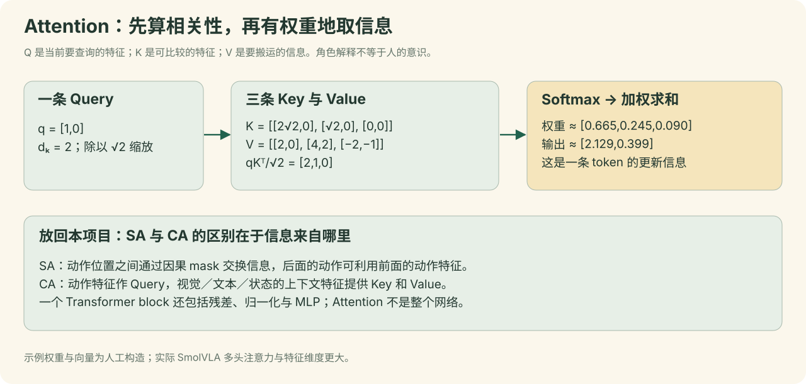

<a name="foundations"></a>

# 09｜读懂模型所需基础：Tensor、MLP与Transformer

[教程目录](../README.md) · [上一章](08-batch-lab.md) · [下一章](10-architecture.md)

> **学习目标：掌握读模型代码所需基础**
>
> 会解释tensor、MLP、token、attention和Transformer基本作用。

## 先认清每种“数”：状态、动作、特征、参数、损失

| 名称 | 用我们的任务解释 | 数字代表什么 | 能否直接发送电机 |
|---|---|---|---|
| 状态 state | 读到的从臂当前6个位置 | 前5维是关节角度，末维是夹爪位置 | 这是观察，不是本次预测结果 |
| 动作 action | 示范时实际发送并经接口返回的目标位置 | 控制器希望从臂到哪里 | 经坐标、范围与执行约束检查后才发送 |
| 特征 feature | 图像/文字/状态转换出的向量 | 网络学习的表示，没有逐维的固定中文定义 | 不能 |
| 参数 parameter | 投影矩阵、Attention的Q/K/V映射矩阵、MLP参数等 | 训练更新的函数系数；部署通常固定 | 不能 |
| 损失 loss | 预测向量场与训练速度标签的误差 | 用来驱动参数更新的评价值 | 不能当抓取成功概率 |

本项目episode22第0帧的实测状态为 `[-5.2747,-77.0989,-0.4835,87.5604,-1.8901,52.1472]`，同帧动作目标为 `[-5.4066,-77.8022,0.0440,87.8242,-1.5385,52.4590]`。它们接近但不相同，是正常的“当前在哪里”和“希望到哪里”之别。请先形成这个区分，再读后面的向量计算。

## Tensor：给一堆数字明确标上各个轴

Tensor（张量）在这里可以先理解为有固定形状的多维数组。一个数是标量，6个关节值组成向量，50行6列组成动作窗口；批量加入另一根“样本轴”。不必先学抽象张量代数，先能逐根解释轴就能读训练代码。[PyTorch张量入门](https://docs.pytorch.org/tutorials/beginner/basics/tensorqs_tutorial.html)

```text
一个关节值                 52.1472                 scalar
一帧6维状态                [6]                     vector
一条50步动作窗口           [50,6]                  时间 × 动作维
8条独立样本的动作窗口      [8,50,6]                样本 × 时间 × 动作维
8张RGB图像                 [8,3,480,640]           样本 × 通道 × 高 × 宽
```

`[8,50,6]`中的8不表示8台机械臂；我们用同一台机械臂采集的不同时间锚点形成8个训练样本。它也不是把一条episode平均切成8份。batch中每个样本拥有自己的当前图像、当前状态和未来50步动作标签。

```python
# 以下是可在已准备好PyTorch的学习环境运行的形状练习，不连接机器人。
import torch
states = torch.tensor([
    [-5.2747254, -77.0988998, -0.4835165, 87.5604401, -1.8901099, 52.1472397],
    [ 2.9890110, -38.4175835,-17.3626366, 53.9780235, -1.3626374, 35.1226997],
])
print(states.shape)
print(states[0, 1].item())
# torch.Size([2,6])
# 约 -77.0989：第1个样本的shoulder_lift
```

这两行数分别取自真实episode22的第0帧与第245帧；为了教学手工拼成batch2，不声称是训练日志中实际抽到的某一个batch。正式训练使用batch8和DataLoader采样器。真实样例数值可打开 `assets/真实数据样例.json`核对。

## Batch 与时间轴为什么特别容易混

设样本甲在episode22第0帧，样本乙在episode22第245帧：

```text
样本甲：观察 I(0), state(0), task → 标签 action(0)…action(49)
样本乙：观察 I(245), state(245), task → 标签 action(245)…action(294)
stack后：
  image   [2,3,480,640]
  state   [2,1,6]  # 观察时间轴T=1，prepare_state之后才是[2,6]
  action  [2,50,6]
```

上面的两行`states`练习只展示当前6维数值如何stack；正式DataLoader的状态还有一个长度1的观察时间轴，实际为`[B,1,6]`，模型`prepare_state`取最后时刻后变成`[B,6]`。图像的T=1轴在返回单张当前观察时被压掉，实际是`[B,3,480,640]`。

从同一段视频抽出的甲、乙仍是两条训练样本；其图像轴上没有未来50帧，因为本次 `n_obs_steps=1`。MP4只是存图像的容器，进入这一版策略的不是一整段55秒成功视频，也不是文件名；数据加载器按时间索引解出当下那一帧，再和同一episode的状态、动作对齐。

Batch的作用是一次并行计算多条题目，并汇总它们的梯度。梯度更新的“一个step”处理一个batch；如果总计12,000个step且batch8，会有96,000次样本抽取位置，但不是96,000条独立新示范，同一训练帧可被反复抽到。

## 标准化：改变数值尺度，不改变动作语义

角度和夹爪值的分布不同。如果某一维自然波动40，另一维只波动1，直接一起平方误差会让大数值维主导。我们按45条训练示范统计均值μ和标准差σ，计算 `z=(x−μ)/(σ+ε)`；验证、推理复用同一组统计量，不再用验证数据重算。

用真实episode22首帧的shoulder_lift做一次近似手算：

```python
x = -77.0988998
mean = -30.2248350  # 来自45条训练集的该状态维
std = 37.2348143
z = (x - mean) / (std + 1e-8)
restored = z * std + mean
print(round(z, 6), round(restored, 4))
# -1.258877 -77.0989（末位随展示精度略变）
```

z约−1.259表示低于训练均值约1.259个标准差，不代表“关节应移动−1.259°”。状态统计与动作统计分别计算；不能拿状态μ/σ反标准化动作。图像走的是另一条缩放路径：uint8像素÷255到0–1，再按策略转换到−1–1；不是用关节的mean/std处理图片。

## Linear：一组输入数怎么变成另一组数

线性层是很多模型部件的基本积木。PyTorch形式为 `y=xWᵀ+b`。W和b是可训练参数；输入x是本次样本。`Linear(32,960)`意味着每个输入的32个数被映射为960个数，**样本数不会因此变成960**。[PyTorch Linear定义](https://docs.pytorch.org/docs/2.11/generated/torch.nn.Linear.html)

下面先用2维输入和3维输出，完整列出每一项：

```python
# 人工构造的教学权重，非真实模型参数。只需Python标准库。
x = [1.0, 2.0]
W = [[1.0, -1.0], [0.5, 0.5], [2.0, 0.0]]
b = [0.0, 1.0, -1.0]
y = [sum(wj*xj for wj,xj in zip(row,x)) + bj for row,bj in zip(W,b)]
print(y)
# [-1.0, 2.5, 1.0]
```

例如第二个输出是 `0.5×1+0.5×2+1=2.5`。本项目 `state_proj:32→960` 做同类运算，只是矩阵更大，W由训练学到，而非人为指定。多出来的特征维度不是新传感器测量值。

## MLP：为什么不能只堆很多线性层

若两个线性层中间什么也不做，`W₂(W₁x+b₁)+b₂`仍等价于一个更大的线性映射。加入非线性函数后，网络才能表达更复杂的输入输出关系。MLP通常指“线性变换→非线性→线性变换”的前馈网络；不同模型可有不同层数和门控结构。

```python
# 人工构造的2→3→1 MLP，使用ReLU方便手算；非本项目真实激活。
h_pre = [-1.0, 2.5, 1.0]         # 上个Linear的输出
h = [max(0.0, v) for v in h_pre] # ReLU: [0.0,2.5,1.0]
out = 1*h[0] + 2*h[1] - h[2] + 0.5
print(h, out)
# [0.0, 2.5, 1.0] 4.5
```

本项目用于融合含噪动作与流时间的MLP是 `1440→720→720`，中间使用**SiLU**（`x×sigmoid(x)`），不是这个练习里的ReLU。动作专家Transformer内部也有前馈网络。MLP负责每个位置内部的非线性特征变换，attention负责位置之间的信息交换，两者角色互补。

### 手算MLP：手写玩具权重，非模型真实参数

```python
x = [0.2, -0.5]
W1 = [[1, 0.5], [-1, 2], [0, 1]]
b1 = [0.1, 0, 0.2]
z = W1 @ x + b1 = [0.05, -1.2, -0.3]
h = ReLU(z) = [0.05, 0, 0]
y = [2, -1, 1] @ h = 0.1
```

只把x₁改为1时，`z=[0.85,-2,-0.3]`，`h=[0.85,0,0]`，输出1.7。这里用ReLU方便计算；SmolVLA动作时间MLP实际采用SiLU，网络大小和任务不同。线性层加非线性激活的计算思想相同。

## Embedding 与 token：不是“把所有东西翻译成文字”

Token可以理解为一个有位置的输入单元。文字token通常由分词器把字符串拆成ID；图像token来自视觉特征；状态token来自状态线性投影；动作token来自一条动作位置的数值投影。

| 输入种类 | 进入模型前 | 变成token后 | 本项目位置数 |
|---|---|---|---|
| 文字 | 分词ID，例如某个整数 | 查embedding表得到960维特征 | 固定补齐到48位置，padding被遮住 |
| 图像 | 512×512 RGB像素 | 视觉编码+压缩，64×960特征 | 64 |
| 状态 | 6个标准化浮点数补到32维 | `Linear(32,960)` | 1 |
| 含噪动作 | 50×32浮点数 | 逐动作位置投影并融合t，50×720特征 | 50 |

因此“113个前缀token”并不表示113个单词；状态没有被转成字符串，图像也没有被强制标成“nut”这个单词。Embedding表通常可以理解为按整数ID取一行参数，视觉与状态投影则是对连续数值做计算。

## Attention：算一次“相关性→加权信息”

注意力先让查询Q与候选键K算匹配分数，用softmax变成加和为1的权重，再对候选值V加权求和。这里的“注意”只是数学运算名称，不是人的意识或一个天然可信的解释器。[Transformer原始论文](https://arxiv.org/abs/1706.03762)



下面用一条Q、三条K、三条V展示公式 `softmax(QKᵀ/√dₖ)V`：

```python
# 人工构造，未提取真实模型注意力。只需Python标准库。
from math import exp, sqrt
q = [1.0, 0.0]
K = [[2*sqrt(2), 0.0], [sqrt(2), 0.0], [0.0, 0.0]]
V = [[2.0, 0.0], [4.0, 2.0], [-2.0, -1.0]]
scores = [sum(qj*kj for qj,kj in zip(q,k))/sqrt(2) for k in K]
exps = [exp(s) for s in scores]
weights = [e/sum(exps) for e in exps]
y = [sum(w*v[j] for w,v in zip(weights,V)) for j in range(2)]
print(scores)
print([round(w,3) for w in weights])
print([round(v,3) for v in y])
# [2.0, 1.0, 0.0]
# [0.665, 0.245, 0.090]
# [2.129, 0.399]
```

这说明两件事：分数最高的第一条会贡献较多信息，但其他条仍能贡献；输出是V的加权组合，不是直接挑一个“最相关物体”。真实模型还会学Q/K/V投影，使用多个头、位置编码、残差和归一化，不能用这张人工例子声称模型已定位螺母。

### 算一次softmax与value加权和

**手算示意，非模型真实注意力。** 设scores为`[2,1,0]`，values为`[10,20,30]`：

| 条件 | softmax权重 | 加权输出 |
| --- | --- | --- |
| 未屏蔽 | [0.665241, 0.244728, 0.090031] | 14.247896 |
| 第3个token为padding | [0.731059, 0.268941, 0.000000] | 12.689414 |

mask在softmax前把不可见位置的score置为−∞；不能先softmax再简单删一个权重，否则剩余和不再等于1。真实value是多维向量，这里压成一个数以便手算。

注意这里有两种常被叫作“权重”的东西：W_Q、W_K、W_V等是保存到模型中的可训练参数；softmax算出的attention weights是针对当前输入临时计算的混合系数，换输入就会变化。优化器并不把每张图的attention矩阵单独存成一个固定参数。

## Transformer：Attention 之外还有什么

一个简化的Transformer block可以按下列顺序理解：

```text
输入token特征 X
 → 归一化 → Attention → 与X相加（残差）
 → 归一化 → MLP       → 再与中间结果相加
输出形状仍是 [B,位置数,隐藏宽度]
```

Attention让不同位置交流；MLP变换每个位置内部的特征；残差给信息与梯度保留直达通路；归一化帮助数值稳定。位置编码告诉网络“第几步/第几个位置”，否则仅看一组无序向量无法表达动作先后。本次实现使用RoPE等位置处理；公式初学时先理解“位置不能丢”。

**Self-attention**与**cross-attention**主要区别在Q/K/V来自哪里：同一组位置产生它们时称self；一组位置提供Q、另一组提供K/V时称cross。SmolVLA把动作专家与VLM结合时交替走这两种路径。因果mask限制晚期信息不能被早期动作位置读取；文本padding mask则只是排除无效占位，不能把两种mask混成一个概念。

## Flow Matching：把学习连续动作拆成两道题

**训练题：**真实示范动作A已知，采噪声ε与流时间t，构造 `x_t=tε+(1−t)A`。让网络根据当前观察和t预测速度 `u=ε−A`。它学的是条件向量场。

**生成题：**A未知，随机初始化一块动作噪声。从t=1向t=0走10轮，逐轮用网络预测的向量场更新整个动作块，最终得到标准化动作。详细手算见后续模型架构章。

这跟“不断给机械臂加随机运动”完全不同：噪声只在神经网络内部的数字数组中，最终动作经过生成、去padding、反标准化与执行器检查后才可能发给机器人。训练时的未来动作标签也不会作为真机输入。

## Backpropagation 与训练：谁在变，什么不变

训练时先forward计算输出和loss；backward利用链式法则求出loss对参数的梯度；optimizer按梯度更新参数。若把一条训练样本看成题目，loss是答题误差，梯度给出“往哪个方向调参数可局部降低误差”。这是局部优化，不保证真实任务必然成功。

```python
# 示意训练一轮，省略本项目的AMP/梯度裁剪/日志等。
optimizer.zero_grad()
loss, info = policy(preprocessor(batch))
loss.backward()
optimizer.step()
```

本项目VLM的参数被冻结，不求这些参数的更新；其特征仍参与forward。动作专家与相关投影更新，`state_proj`也允许训练。冻结不等于跳过该模块，更不等于把同一张图片的特征重复用于所有样本。我们使用完整预训练策略作起点，50条示范是在适配具体任务，不能把它解释为从零创造通用机器人能力。

### 做一次最小梯度更新

```python
x, target, w = 2, 1, 0.2
prediction = w*x = 0.4
loss = (prediction-target)**2 = 0.36
grad = 2*(prediction-target)*x = -2.4
w_new = w - learning_rate*grad
```

| 教学学习率 | w_new | 新预测 | 新loss |
| --- | --- | --- | --- |
| 0.01 | 0.224000 | 0.448000 | 0.304704 |
| 0.1 | 0.440000 | 0.880000 | 0.014400 |
| 1.0 | 2.600000 | 5.200000 | 17.640000 |

学习率过大可以越过最优点，让loss变大。这是普通标量梯度下降的教学例；本项目真实训练用AdamW、梯度裁剪及1e-4量级计划学习率，不应复制这里的0.1或1。

## 泛化、分布偏移、闭环：入行必须建立的三个判断

**泛化**是面对未在训练中完整出现的情形仍能完成任务。单次成功证明这个条件下跑通了一次；要说成功率，需要预先规定场景范围和重复次数。验证loss只检验离线示范拟合，不直接测试滑动和夹持。

**分布偏移**是部署观察与训练不同。例如示范里螺母经常在图像下方，部署却被放到边缘；或训练从臂起姿不统一，部署又从罕见构型开始。固定归位与机位一致性减少了部分变化，但并没有增加模型未见过的摩擦和目标朝向知识。

**闭环**是执行后重新观察、再决定后续动作。SmolVLA一次给出一块50步动作，不代表这50步每一步都用到了新画面。我们的执行器在块与块之间更新观察，并用关节反馈限幅；关节反馈闭环与视觉任务闭环处在不同层，不能把“60Hz伺服”说成“60Hz视觉推理”。

## 练习：用你自己的话说清一张图怎样变成一次电机目标

按这个顺序检查：RGB像素→当前样本→batch→预处理→视觉/文字/状态特征→动作专家→10轮采样→50×6目标→队列与限幅→单次电机目标→新观察。能为每个箭头说出输入形状、输出形状和负责人，就已经具备继续阅读具身智能工程代码的基础。

本章所有小网络权重、attention数字与Flow Matching标量均为人工教学算例；真实来源仅用于明确标注的episode数值和项目统计。学习代码不涉及串口、相机连接或机械臂控制。

---

**停一下，用自己的话回答：** 为什么MLP不能只堆几层线性映射而不要激活？

<details>
<summary>参考答案</summary>

多个线性/仿射映射可合并成一个；激活函数提供非线性，才能表达更复杂关系。

</details>

[教程目录](../README.md) · [上一章](08-batch-lab.md) · [下一章](10-architecture.md)
