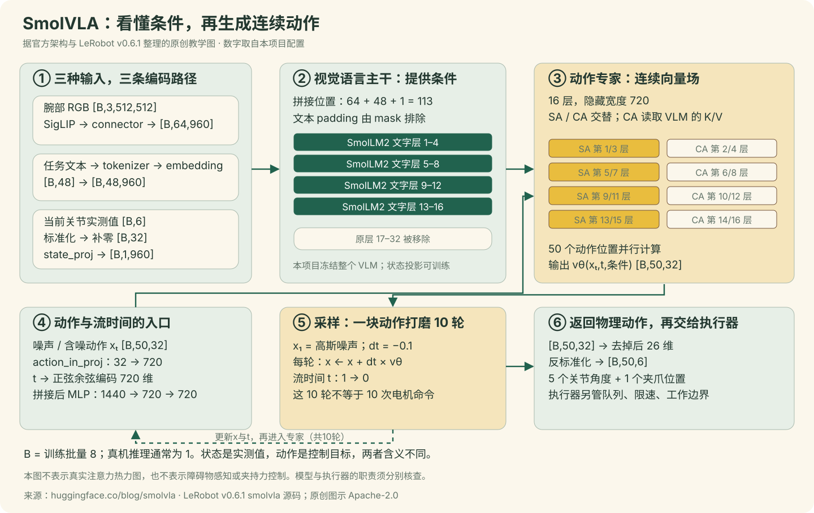
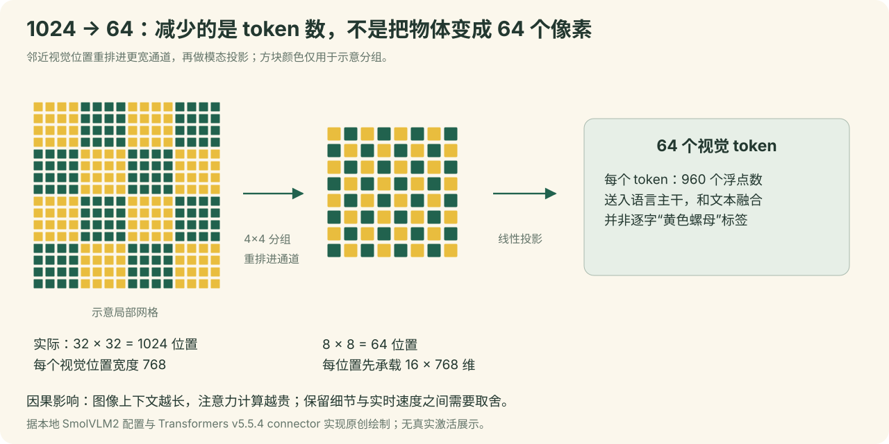

<a name="architecture"></a>

# 10｜SmolVLA 的主要架构与输入输出

[教程目录](../README.md) · [上一章](09-foundations.md) · [下一章](11-forward.md)

> **学习目标：读懂官方架构的设计动机**
>
> 能解释视觉压缩、16层文本主干、状态token和动作专家。

## 先分清训练接口与部署接口

| 接口位置 | 训练B=8 | 部署B=1 |
|---|---|---|
| 当前RGB | `[8,3,480,640] uint8`，trainer先转0–1 | 手工组为`[1,3,480,640] float32`，0–1 |
| 原始/预处理状态 | `[8,1,6]`，含1个观察时刻 | `[1,6]` |
| prepare_state之后 | `[8,32]`，取最后观测并补26维0 | `[1,32]` |
| 监督动作 | `[8,50,6]`，处理后标准化再补32 | 没有真实未来action输入 |
| 最终动作接口 | loss比较真实6维有效标签 | `[1,50,6]`，反标准化后交给执行器 |

这是2026-10-21通过实际训练reader、DataLoader、检查点processor和prepare helper读出的阶段差异。网络特征输出的64/960/720等尺寸继续依据配置与源码推导，不冒充本页运行出的隐藏激活。

## 先回答：SmolVLA 到底帮我们学到了什么

本项目学习的函数可以写成 `π(当前腕部图像, 当前6维关节状态, 任务指令) → 未来50步6维关节目标`。这里的“未来”来自人示范中接下来发生的动作；模型没有读取未来视频。训练时有未来动作作为答案，部署时只能根据当前观察预测。

这件事包含两个难度不同的问题：识别图像与任务之间的关系，以及把这些条件变成机器人能执行的连续动作。SmolVLA 沿用已经学过视觉与语言的 SmolVLM2，再用动作专家学习连续轨迹。官方通用方法还包含多相机、社区数据预训练和异步执行；我们这次用其预训练模型，在一台 SO-101、一只腕部相机、一个黄色螺母任务上做微调。[官方方法介绍](https://huggingface.co/blog/smolvla#method)

“SmolVLM2-500M”是所选基础 VLM 的型号；“SmolVLA-450M”是经过结构调整后整个 VLA 的规模名。不能把两者相加，理解成 950M。本次实际模型参数总数为450,046,176，可训练参数99,880,992；约一亿参数参与更新，其余冻结。`5000步`则是优化器更新次数，既不是参数数量，也不是50步动作窗口。

## 对照官方架构图，按六个区域读懂一次预测



图是根据技术结构与本项目代码原创绘制的教学图，并非复制官网图片。可对照[官方博客 Figure 2 架构原图](https://huggingface.co/blog/smolvla#meet-smolvla)及[论文 Figure 1](https://arxiv.org/html/2506.01844v1#S3.SS1)。数字依据本地冻结代码快照和实际 `config.json`，因此可以从图定位回实现。

| 图中区域 | 输入 → 输出 | 在黄色螺母任务中解决什么 | 如果删掉会怎样 |
|---|---|---|---|
| ① 图像、文字、状态入口 | 三类不同数据 → 可处理的向量序列 | 图像提供可见场景，指令提供任务条件，实测状态提供机械臂现在的构型 | 只有图像时，相似画面可能对应不同关节姿态；只有状态时，不知道螺母在哪里 |
| ② VLM 前缀 | 64视觉位置 + 48文字位置 + 1状态位置 → 上下文特征 | 让图像与“yellow nut / brown tray”这条指令一起成为动作预测的条件 | 从50条示范开始重学全部视觉语言能力，需要不同规模的数据与训练预算 |
| ③ 动作专家 | 条件特征 + 50个含噪动作位置 → 50个速度向量 | 学习接近、夹取、移动、松开的连续动作模式 | VLM的普通文本输出无法直接替代可靠的关节目标序列 |
| ④ 动作与流时间入口 | `[B,50,32]`和`[B]` → `[B,50,720]` | 告诉专家当前这块动作仍有多少噪声 | 同一个中间值在不同噪声阶段可能需要不同修改方向 |
| ⑤ Flow Matching 采样 | 噪声经10轮更新 → 一块连续动作 | 同时更新整个动作窗口，无需逐个关节数字地“续写”文本 | 直接用随机噪声作动作毫无任务意义 |
| ⑥ 物理动作出口 | 去维度padding、反标准化 → `[B,50,6]` | 恢复关节角度和夹爪位置，供控制程序读取 | 标准化空间的1.0不能直接解释为关节1° |

其中 `B=8` 是本次训练批量；真机每次只预测一台机器人，通常 `B=1`。图中113个前缀位置包含文字padding位置；这些占位位置由 mask 排除，不是113条有意义观测。图像/文字 token 是特征，不是显式检测出的物体框。本项目没有另外训练一个“螺母坐标检测器”。

## 从像素到64个视觉 token：SigLIP 与 connector 各做什么

相机存的是640×480 RGB画面，网络不直接理解“这张图里有螺母”。它先接收像素数值，经本项目图像处理成为 `[B,3,512,512]`；接着视觉编码器把局部纹理、形状和位置关系编码成特征。

SmolVLM2的视觉编码部分来自SigLIP体系。可以把“视觉编码器”理解为训练过的图像特征提取网络，而不是把图片转成一句文字。SmolVLA调用 `vision_model(...).last_hidden_state`，随后调用 `connector`，并不先调用VLM生成一段描述再把描述输入控制器。[官方视觉模型说明](https://huggingface.co/docs/transformers/model_doc/siglip)，[本地调用代码](../code/lerobot/smolvlm_with_expert.py#L202)



按本地配置计算：

```python
# 以下是形状推导，未在Mac加载模型。
image = [B, 3, 512, 512]
patch_size = 16
patch_grid = [512 // 16, 512 // 16]  # 32 × 32
vision_hidden = [B, 1024, 768]       # 32 × 32 个位置

# connector 的 pixel shuffle：4×4邻近位置重排到通道
shuffled = [B, 64, 768 * 4 * 4]     # 8×8位置，每位置12288维
visual_tokens = [B, 64, 960]        # 再投影到语言主干宽度
```

这是**位置数压缩**：相邻4×4组的特征被放进一个更宽向量，并非只随机留下每16个像素中的一个。投影后每帧64个视觉token，减少后续注意力要处理的位置。若后续所有位置都两两比较，仅视觉位置从1024降到64，比较格子的数量从1,048,576降到4,096；这个256倍只是位置对数量的算术示意，不能说整个模型必然提速256倍。实际成本还包括视觉编码器、投影、文字、动作和硬件执行。[connector实现](https://github.com/huggingface/transformers/blob/v5.5.4/src/transformers/models/smolvlm/modeling_smolvlm.py)

原生SmolVLM2能把高分辨率图像切成多个局部图块并结合全局图。SmolVLA为了降低开销只用全局图像，并压缩视觉token。这是速度与细节之间的取舍；对于黄色螺母这种小物体，机位、有效像素、清晰度和夹爪遮挡因此格外重要，不能以“模型有视觉能力”代替采集质量。[官方视觉token压缩设计](https://huggingface.co/blog/smolvla#visual-token-reduction)

## 图像、指令和机器人状态怎样进入同一主干

三种输入不能直接拼原始数值，因为像素、文字ID、关节角度的形状与尺度不同。先分别编码到960维：

```python
# 与本项目结构相同的教学伪代码，省略设备和dtype细节。
img_emb = embed_image(image)                  # [8,64,960]
text_emb = embed_language_tokens(token_ids)  # [8,48,960]
state_now = normalized_state[:, -1, :]       # [8,1,6] → [8,6]
state32 = pad_right(state_now, 32)            # [8,32]
state_emb = state_proj(state32)[:, None, :]  # [8,1,960]
prefix = cat([img_emb, text_emb, state_emb], dim=1)
print(prefix.shape)
# torch.Size([8,113,960])
```

训练DataLoader与preprocessor阶段的状态实际是 `[8,1,6]`，保留长度1的观察时间轴；`prepare_state`取最后观察变成 `[8,6]`，再补到32维。部署手工组batch时通常直接是 `[1,6]`。图中状态入口画的是取出当前状态后的形状，不能把它误认为训练原始batch的形状。

同样是960维，只说明它们能进入同一计算通道，不说明每一维有可命名的含义，例如第19维并不必然等于“螺母黄色程度”。这些向量经过注意力与MLP混合后，才形成用于下游动作的上下文特征。当前关节状态直接经过线性层，不会被拼成诸如“shoulder lift -77 degrees”的文字。

代码还有方向约束：图像和文字属于可互相查看的一组；状态可以读取这组条件；图像文字不能读后面的状态或动作；动作也不能让未来动作标签倒流进视觉前缀。文字padding位置由有效位mask关闭。这样在训练时给了未来动作答案，也不会让观察编码器直接偷看答案。[前缀与掩码构造](../code/lerobot/modeling_smolvla.py#L553)

## “跳过一半层”到底跳过哪里

实际构造代码执行的是 `text_model.layers[:16]`：SmolVLM2文字主干原有32层，保留前16层。**这里截短的是VLM里的文字Transformer主干，不是把SigLIP视觉编码器砍掉一半。** 官方博客有一处“vision model layers”的宽泛写法，应以论文方法段和本项目版本代码为准。[v0.6.1实际截层位置](https://github.com/huggingface/lerobot/blob/v0.6.1/src/lerobot/policies/smolvla/smolvlm_with_expert.py#L102-L106)

这样做不是断言“后16层永远没用”，而是该方法在机器人动作预测中选择中间层特征，以较小的计算成本取得有用条件。我们的动作专家也使用16层，隐藏宽度是960×0.75=720。少一半文字层、较窄动作专家、较少视觉位置共同降低开销；不能把全部节省归因于BF16。

## 动作专家不是第二个聊天机器人

它不输出“现在向下移动，然后夹紧”的文字规划，而是输出与含噪动作同形状的数值向量场。形状路线是：

```text
含噪动作 x_t                         [8,50,32]
  └─ action_in_proj：32→720           [8,50,720]
流时间 t                             [8]
  └─ 正弦余弦编码                    [8,720]
  └─ 广播到50个动作位置              [8,50,720]
拼接动作/时间特征                    [8,50,1440]
  └─ Linear→SiLU→Linear              [8,50,720]
16层动作专家（读取VLM条件）           [8,50,720]
  └─ action_out_proj：720→32          [8,50,32]
```

这里50是动作序列的长度，32是模型统一预留的动作维度；我们的真实机器人只有6维。训练损失只使用实际6维，并排除越过episode结尾的时间padding；部署也只取前6维后反标准化。不要把32维误解为SO-101有32个关节。[动作投影与时间MLP](../code/lerobot/modeling_smolvla.py#L646)

## 为什么交替 self-attention 和 cross-attention

可以把动作窗口中的第k步当成一条“正在完善的动作特征”。它一方面需要知道图像中的物体与任务条件，另一方面需要与窗口里前面的动作协调。

- **Cross-attention（CA）：**动作特征提供Query，VLM上下文提供Key、Value，相当于“我这一步应从当前观察中取哪些信息”。
- **Self-attention（SA）：**动作位置通过因果mask交流；较晚的动作位置可使用较早位置的特征，较早位置不能偷看后面的动作特征。

本项目 `self_attn_every_n_layers=2`，从程序的0号层开始，偶数层走SA路径、奇数层走CA路径，按人阅读的1号起始即1/3/5…为SA，2/4/6…为CA。需注意v0.6.1的SA实现把前缀与动作的Q/K/V按位置拼接，再应用块状掩码；因此动作位置在SA层也可读取合法的前缀，并非“SA层只有动作，CA层才看到图像”这样绝对分离。[实际两条注意力路径](../code/lerobot/smolvlm_with_expert.py#L220)

注意力的因果约束不等于推理时必须预测完第1步再预测第2步。每轮Flow Matching仍对50个动作位置并行计算，只是每个位置允许使用的信息受到mask限制。位置的先后关系与数值计算的并行性，是两件事。

## KV cache 在这里缓存什么，为什么能省计算

一次动作预测的10轮采样共享同一张当前图像、同一条指令、同一组当前状态。先编码这些条件，在每层保存Key/Value；后续每轮主要更新含噪动作，再读取这些缓存。代码里先调用 `embed_prefix` 和前缀prefill，再进入Euler循环。[实际采样入口](../code/lerobot/modeling_smolvla.py#L727)

缓存不是把上一次机器人画面永久保存下来，也不是把下一次控制观察全部省略。换了观察、下一次预测新动作块，条件需要更新。本项目的最新请求队列与新画面约束在执行器中负责，神经网络的KV cache本身不承担机器人状态同步。

## 哪些是SmolVLA通用机制，哪些是我们这次的选择

| 范围 | 官方机制 / 选项 | 本项目最终采用 |
|---|---|---|
| 初始化 | VLM能力与社区机器人动作预训练 | 载入完整`lerobot/smolvla_base`后微调；并非50条从随机权重训练 |
| 相机与观察历史 | 支持多相机输入 | 1只腕部相机，`n_obs_steps=1`，每次观察只取当前帧 |
| 模型结构 | VLM + 连续动作专家 + Flow Matching | 前16文字层、专家16层720宽、每次50步、10轮采样 |
| 数据任务 | 通用预训练包含多种机器人/任务 | 单SO-101、固定任务文字、50条示范；45训练、5验证 |
| 更新参数 | 冻结/微调设置可配置 | VLM冻结，动作专家与相关投影更新，状态投影可训练；未用LoRA |
| 精度与批量 | 依硬件可配置 | RTX 5060 Laptop 8GB、BF16、batch8 |
| 动作表达 | 取决于数据定义 | 从臂坐标系的绝对关节目标；前5维角度，夹爪归一化位置 |
| 执行程序 | 官方支持同步/异步机制 | 项目`trajectory-phase-v7`执行器；按实际限速进度接续完整动作块 |
| 额外控制 | 模型自身不等于完整机器人应用 | 两次Enter、固定归位、边界、限速、相机/推理看门狗由项目程序实现 |

还有一个容易误读的字段：发布配置的 `load_vlm_weights=false` 不表示我们把VLM从零训练了。完整SmolVLA检查点加载时会恢复整个策略的权重；该字段控制构造期间是否额外从独立VLM仓库初始化。判断训练初始化必须看 `from_pretrained` 的实际入口与完整权重加载，而不能只看这个布尔值。

## 读完后，用三个问题验证自己是否理解

1. 为什么当前输入是一帧图像，训练答案却能有50步动作？因为数据加载器以当前帧为观察锚点，读取同episode未来动作作为监督，不会把未来视频当输入。
2. 为什么模型输出32维却不能给SO-101发送32个关节命令？32是统一模型维度；本机器人真实动作只有6维，需去padding并反标准化。
3. 为什么loss下降后仍可能夹不起？loss衡量标准化动作空间里的拟合；物体滑动、夹爪接触、示范覆盖、观察偏移和执行时序都仍会影响真实结果。

**来源与图示许可说明。** 本章架构依据[官方博客](https://huggingface.co/blog/smolvla)、[论文方法第3节](https://arxiv.org/html/2506.01844v1#S3.SS1)与本地LeRobot v0.6.1代码共同核对；具体张量维度和方向以本项目配置及代码为准。官网原图版权不从代码许可证推定；本页使用原创SVG结构图，不复制原图排版。原创教学SVG按Apache-2.0提供，来源清单与核对记录见 `assets/official/来源与许可.md`。

### 沿张量走一遍

| 阶段 | 当前配置与输入输出 |
| --- | --- |
| 输入 | 当前RGB、state和固定英文task；训练还提供50×6动作标签 |
| 条件token | 64视觉 + 48文本位置 + 1状态 = 113逻辑位置；文本仅14个有效，合计79个有效位置 |
| VLM文本主干 | 16层、hidden size960；本轮冻结参数，仍计算前向特征 |
| 动作专家 | 16层、hidden size720；训练约9988万参数 |
| 输出 | 一次完整预测50×6；反归一化后才回真实关节目标单位 |

截取的是文本主干前16/32层，不是截掉一半SigLIP视觉编码器。详细结构见本章原创SVG和源码。

---

**停一下，用自己的话回答：** 64个视觉token是否等于64个检测出的物体？

<details>
<summary>参考答案</summary>

不是。它们是编码与重采样得到的空间特征位置，每个含多维信息，并不与物体数一一对应。

</details>

[教程目录](../README.md) · [上一章](09-foundations.md) · [下一章](11-forward.md)
