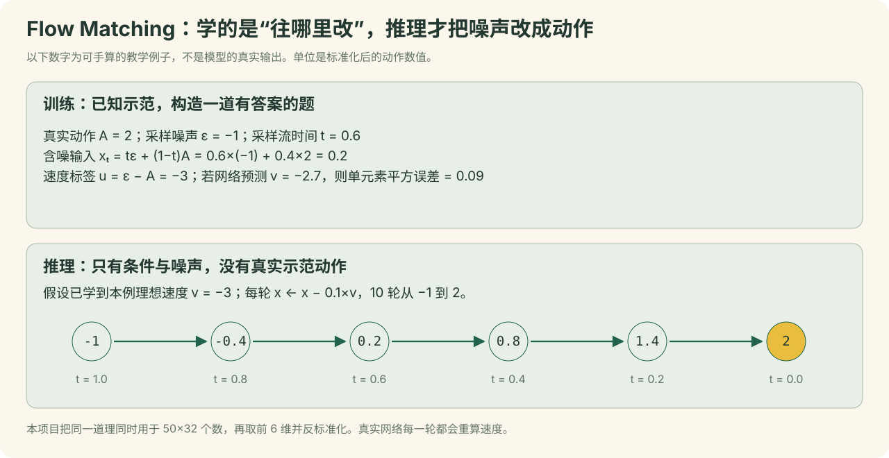

<a name="flow"></a>

# 12｜训练到底优化什么：Flow Matching

[教程目录](../README.md) · [上一章](11-forward.md) · [下一章](13-training.md)

> **学习目标：理解生成式动作学习**
>
> 能手算x_t、速度标签、MSE和反向Euler一步。

令A为标准化后的真实50步动作，ε为同形状标准高斯噪声，t为每个样本随机抽取的时间。当前代码采样 `t = Beta(1.5,1.0) × 0.999 + 0.001`，训练构造：

```text
x_t = t·ε + (1−t)·A
u_t = ε − A
v_θ = 动作专家(x_t, t | 图像、文本、状态)
loss = 有效时间位置、实际6维上的 mean((v_θ − u_t)²)
```

t接近0时输入接近真实动作，接近1时输入接近噪声。网络学习这条路径的速度场。它没有用“成功奖励”做强化学习，也没有让机器人在训练中自主试错；监督来自已录制的演示目标。

默认损失先截取真实6维，再用 `~action_is_pad` 掩码相乘；分母为有效时间位置数×6，而不是无条件除以50×32。因此临近episode末尾的补齐不作为真实动作监督。本项目复用官方损失，没有额外增加接触力损失、物体位置损失、成功分类头或轨迹平滑正则。

推理从t=1走到0，步长Δt=−0.1：

```python
x = gaussian_noise(shape=(1, 50, 32))
for k in range(10):
    t = 1.0 - k / 10
    velocity = denoise_step(x, t, cached_prefix)
    x = x - 0.1 * velocity
actions = unnormalize(x[..., :6], action_stats)
```

这里的10是求解器迭代次数，50是预测动作数，30是数据FPS，60是上位机目标发送Hz，电机内部伺服频率未测定，四个数的含义独立。10次去噪不等于机械臂移动10次。离线交互包动画用简化的一维路径解释噪声插值和反向积分，不展示真实网络激活。

### 把一个真实动作标量代入Flow Matching

A取自真实batch的`b=0,k=0,j=0`归一化动作；ε与v̂是为手算指定的教学数，非某次模型预测：

```python
A = -0.205827981
epsilon = 0.8
t = 0.5
x_t = t*epsilon + (1-t)*A = 0.297086009
u_t = epsilon - A = 1.005827981
v_hat = 0.1  # 教学假设
loss = (v_hat-u_t)**2 = 0.820524332
# 示意负步长Euler一次：
x_next = x_t + (-0.1)*v_hat = 0.287086009
```

这里只算一个有效标量。真实训练按有效时间步×6维取平均，padding不贡献分子或分母；网络必须学习条件速度场，不会在推理中拿到真实A。

## Flow Matching：先看一个可以手算的数值例子



**本小节的数值为教学构造，未读取或声称展示模型内部激活。** 先把50×32个动作数缩成1个数：假设标准化后的示范动作 `A=2`，采样噪声 `ε=-1`，流时间 `t=0.6`。

```python
A = 2.0
eps = -1.0
t = 0.6
x_t = t * eps + (1 - t) * A   # 0.2：这就是送给网络的含噪输入
u_t = eps - A                # -3：训练速度标签
v_pred = -2.7                # 人工假设的预测，仅用来演示loss
loss = (v_pred - u_t) ** 2
print(x_t, u_t, round(loss, 2))
# 0.2 -3.0 0.09
```

训练时示范答案A已知，所以能够构造含噪输入与速度标签。网络同时接收观察条件与t，学习从含噪动作到应修正方向的关系。不同样本、不同训练更新重新采样噪声与t；不是把每条示范永久污染后存成新标签。实际t采样为 `Beta(1.5,1.0)*0.999+0.001`，一条样本的t广播给其整块动作。[本次训练公式代码](../code/lerobot/modeling_smolvla.py#L689)

部署时A未知。先采一块 `[1,50,32]` 噪声，然后沿已学向量场走10次Euler步：

```python
# 教学版，与本地采样方向一致；denoise为已经训练好的网络。
x = noise                  # t=1，最初是噪声
dt = -1.0 / 10
for step in range(10):
    t = 1.0 + step * dt
    v = denoise(x, t, observation_condition)
    x = x + dt * v
# x近似t=0的标准化动作；截到真实6维后反标准化
```

沿上面的单数值例子，若理想网络始终输出−3，负步长使 `x` 每轮加0.3，从−1走到2。这也解释了为什么速度标签是 `noise-action`，不能看到负号后自行改成 `action-noise`；公式与积分方向必须配套。本文统一使用实际代码的t定义，避免与其他文章中“0是噪声、1是数据”的τ约定混用。[Euler积分实现](../code/lerobot/flow_matching.py#L61)

在真实网络中每轮v会随x、t和观察条件变化；不是恒速，也不能保证10轮后等于任意一条示范。Flow Matching允许在条件下学习连续动作的分布，较适合多种可行动作路径；它不能凭名称提供抓取力、碰撞证明或物理成功保证。

## 训练、采样、执行：三个完全不同的时间轴

| 时间轴 | 本项目数字 | 一次“步”改变什么 |
|---|---|---|
| 优化器更新步 | 完成12,000，选5,000检查点 | 用训练batch的梯度更新可训练参数 |
| Flow Matching流时间 | 从1走向0，10轮 | 同一块含噪动作的数值；尚未执行电机 |
| 机器人动作时间 | 每块50步，数据标称30FPS | 随时间展开关节控制目标；执行器按60Hz限速跟踪 |

一次模型预测产生50步动作；一次预测内部包含10轮动作专家计算；模型推理频率也不自动等于相机30FPS或伺服60Hz。模型生成和安全执行的时序分离，正是后续队列、限幅与动作相位章节需要单独学习的原因。


### 噪声时间t与机器人时间不是一回事

| 噪声时间 | 混合值 xₜ | 含义 |
| --- | --- | --- |
| t=1 | ε | 推理从噪声端开始 |
| t=0.5 | 0.5ε+0.5A | 训练中的一个中间位置 |
| t=0 | A | 数据端 |

教学理想场若始终知道`u=ε−A`，10次`dt=−0.1`可从ε积分到A；真实推理不知道A，使用网络预测的速度，因此不能保证沿直线恢复。10次积分更新整块50步动作，不等于机器人移动10次，与30FPS/60Hz的真实时间展开无关。

[一维轨迹与10步积分演示下载](https://github.com/damonwangk/so101-yellow-nut-smolvla/releases/download/tutorial-v1.0/so101-smolvla-tutorial-offline.zip)：解压后打开 `开始阅读.html`。本页提供可直接在 GitHub 阅读的静态实例，离线包保留全部滑块、逐帧选择与动画。

---

**停一下，用自己的话回答：** num_steps=10与chunk_size=50是什么关系？

<details>
<summary>参考答案</summary>

前者是每次生成动作块的积分次数；后者是该块的未来动作数量。不是控制机械臂10次或把50步训练做10遍。

</details>

[教程目录](../README.md) · [上一章](11-forward.md) · [下一章](13-training.md)
