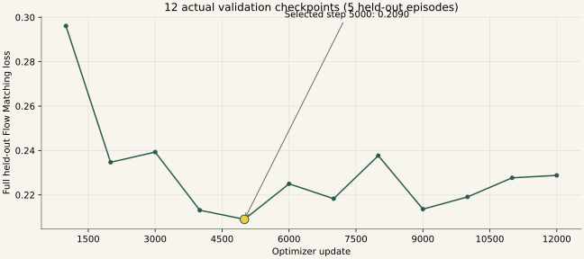

<a name="evaluation"></a>

# 14｜为什么选择5000步，离线验收又证明什么

[教程目录](../README.md) · [上一章](13-training.md) · [下一章](15-deployment.md)

> **学习目标：学会解释证据**
>
> 能区分留出loss、动作误差、真机一次成功和统计成功率。

## 真实的验证轨迹

每1000步对完整5条保留示范计算 Flow Matching loss，使用训练集统计。循环把各验证batch的标量loss取平均；本轮2848帧按batch8刚好356整批，没有较小尾批。换成不能整除的数据规模时，该实现仍按batch平均。它是当前实现的记录值，不应另称为逐帧严格加权的物理误差。随机噪声与时间也会带来波动。

| 步数 | 验证loss | 步数 | 验证loss |
|---:|---:|---:|---:|
|1000|0.2961|7000|0.2183|
|2000|0.2347|8000|0.2377|
|3000|0.2393|9000|0.2136|
|4000|0.2131|10000|0.2191|
|5000|**0.2090**|11000|0.2277|
|6000|0.2250|12000|0.2288|

训练单batch loss还会下降，但留出示范没有持续改善，所以按约定在12000步完成验证及保存后结束，保留全部13个检查点，以5000步作为优先部署候选。最低验证loss是一种选模依据，不能推导“成功率79.1%”。

### 真实完整验证结果



| 优化step | 保留集Flow Matching loss | 说明 |
| --- | --- | --- |
| 1000 | 0.2961 |  |
| 2000 | 0.2347 |  |
| 3000 | 0.2393 |  |
| 4000 | 0.2131 |  |
| 5000 | 0.2090 | 本轮最低、选用模型 |
| 6000 | 0.2250 |  |
| 7000 | 0.2183 |  |
| 8000 | 0.2377 |  |
| 9000 | 0.2136 |  |
| 10000 | 0.2191 |  |
| 11000 | 0.2277 |  |
| 12000 | 0.2288 |  |

最低记录为第5000步的0.2090。本快照有485个实际记录的单batch训练点与12次完整验证，没有补造未记录的step。单batch训练loss与完整保留集loss不是同一种统计；这些数也不能直接换算为抓取成功率。

[全部提取指标JSON](../assets/真实训练指标.json)

[真实训练与验证曲线下载](https://github.com/damonwangk/so101-yellow-nut-smolvla/releases/download/tutorial-v1.0/so101-smolvla-tutorial-offline.zip)：解压后打开 `开始阅读.html`。本页提供可直接在 GitHub 阅读的静态实例，离线包保留全部滑块、逐帧选择与动画。

## 第5000步离线检查

严格加载500个权重张量、450,046,176个元素，全部有限；归一化统计与45条训练集一致。验证集100个不同观测、2个随机种子共200段50×6预测，60000个数值全部有限；比较时排除末尾padding。

五个身体关节平均MAE：首动作约1.73°，前10步2.03°，完整50步3.66°；夹爪首动作约1.05个百分点。50步保持当前姿势基线的身体误差约5.65°，说明模型有部分未来轨迹预测能力；首动作保持基线约0.94°，反而比模型更低。肩抬升完整窗口最大误差52.21°，平均值不能掩盖个别大误差。

200次中35次首目标有越界，83次首目标需要既有单次限幅；因此不能把原始预测直接发送电机。图像和状态来自示范，预测不会改变下一帧观察，这是条件动作预测检查，不能替代闭环真机评估。报告里早期“先用短执行窗口”的建议属于部署前阶段；后续实测发现本执行器的15帧换段截断松爪尾部，最终v7按完整段执行，详见[执行器章节](16-execution.md)。


## 怎样计算成功率，而不被一次成功说服

若未来在明确重摆规则下做20次独立测试，假设15次完整入盘，则点估计是15/20=75%。这是教学假设，不是本项目已有结果。即使记录75%，还应说明位置/朝向、固定起点、超时和中断规则；20次样本的不确定性仍很大。用[Wilson方法（NIST公式）](https://www.itl.nist.gov/div898/handbook/prc/section2/prc241.htm)估计，该假设下95%区间约53%–89%，说明小样本不能支持很精确的性能承诺。方法与本地可核算示例见下方；它也依赖独立、同条件伯努利试验的近似，连续重复同一简单位置不能自动代表广泛泛化。

```python
# 纯Python教学算例；不会驱动机械臂
n, successes, z = 20, 15, 1.96
p = successes / n
denom = 1 + z*z/n
center = (p + z*z/(2*n)) / denom
half = z*((p*(1-p)/n + z*z/(4*n*n))**0.5) / denom
print(round(p, 3), round(center-half, 3), round(center+half, 3))
# 0.75 0.531 0.888
```

---

**停一下，用自己的话回答：** val_loss=0.209是否等于成功率79.1%？

<details>
<summary>参考答案</summary>

没有这种换算。它是标准化动作空间的速度场预测损失，真实成功率需要多次独立实机试验。

</details>

[教程目录](../README.md) · [上一章](13-training.md) · [下一章](15-deployment.md)
