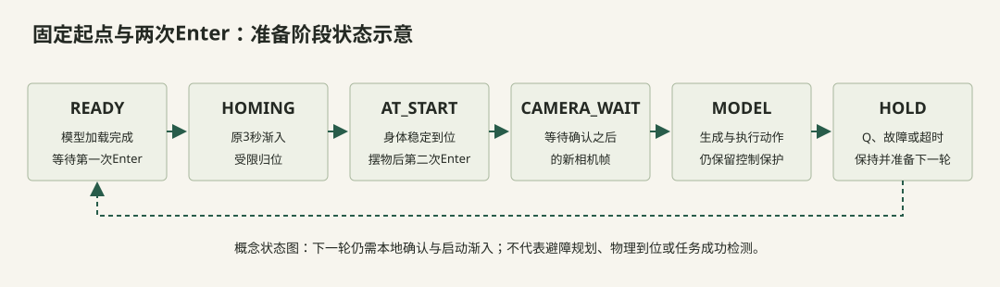
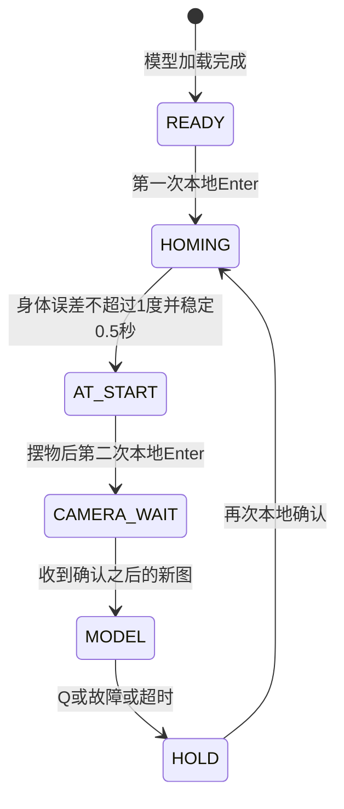

<a name="homing"></a>

# 17｜固定起点与两次Enter，减少起始不确定性

[教程目录](../README.md) · [上一章](16-execution.md) · [下一章](18-pitfalls.md)

> **学习目标：减少起始分布变化**
>
> 理解medoid、稳定判定、二次确认和新帧门控。

训练示范起始姿态不一致，腕部相机视角也随之变化。物体在图像中相同位置时，机械臂状态可能不同；启动瞬间若又正在摆物，第一段预测会混入人为干扰。固定准备姿态主要减少这些变量，不会补出训练中没有的抓取接触策略。

## 为什么选episode22

只从45条训练示范的起始状态选，过滤后43个合法候选；用稳健归一化后的平均L1距离选代表点（medoid）。最终是实际存在的episode22第0帧，不是逐关节中位数拼成的一组未出现姿态；验证集未参与选择。

| 身体 / 夹爪 | 固定目标 |
|---|---:|
| shoulder_pan | −5.274725° |
| shoulder_lift | −77.098900° |
| elbow_flex | −0.483516° |
| wrist_flex | 87.560440° |
| wrist_roll | −1.890110° |
| gripper | 52.147240个百分点 |

`yellow-model-start-pose.json`绑定坐标版本和控制配置哈希；配置变化必须重新核对准备姿态。手机初始摆放照片展示场景，精确关节准备姿态和相机图以该真实训练帧为准。

## 状态机顺序

```text
LOADING → READY（显示第一次Enter）
→ 原3秒启动 + 受限归位
→ 身体五关节误差≤1°并稳定0.5秒
→ AT_START（保持力矩，才显示第二次Enter）
→ 操作员摆好螺母并确认
→ CAMERA_WAIT（必须收到确认时刻之后的新图像）
→ MODEL（开始本轮45秒计时）
```

夹爪不参与身体归位到达判定。Q/R/故障取消准备；归位停滞或超时转HOLD。第二次Enter后不能用归位前缓存的画面启动推理。界面文字按阶段显示，是为了让操作者知道当前哪个确认有效。



<details>
<summary>查看Mermaid图源码</summary>



</details>

这是启动软件状态机的示意，不是回位避障规划。夹爪不参加身体到位判定；必须在归位完成后再确认，且不能用确认之前的缓存画面启动推理。归位路径需要现场留空与独立验证。

[FixedStart实现](../code/project/yellow_start_pose.py#L22) · [两次Enter可操作状态机下载](https://github.com/damonwangk/so101-yellow-nut-smolvla/releases/download/tutorial-v1.0/so101-smolvla-tutorial-offline.zip)：解压后打开 `开始阅读.html`。本页提供可直接在 GitHub 阅读的静态实例，离线包保留全部滑块、逐帧选择与动画。

固定归位沿受限关节路径移动，没有规划避障。因此归位时路径应留空，`AT_START` 后再摆物。当前参考设备已由操作员确认完成任务；另一台机械臂的归位路径仍需单独验证，不能因为终点在范围内就推断途中不会碰桌面。


## 到位为什么要连续稳定，而不是某一帧碰到阈值

用教学时刻说明：10.0秒身体误差0.8°开始计时；10.3秒误差又到1.2°，计时清零；10.4秒重新降到0.7°，需要一直保持≤1°到10.9秒才算稳定0.5秒。夹爪不参加该身体到位门槛。第二次确认如果发生在100.000秒，缓存图时刻99.980秒仍不够新，要等100.020秒这样的确认后新帧。以上时间均为解释状态机而设。

medoid也可以先在一维理解：候选[−80,−76,−70]互相的平均绝对距离（含自身零距离）约4.67、3.33、5.33，所以选真实存在的−76。实际程序在六维稳健尺度上选episode22，不是用这个一维算例替代实际得分。

## 固定起点是在减少哪一种变化

腕部相机随着关节运动。同一颗螺母在桌面不动，起始肩肘角不同也会导致视角、遮挡和像素位置变化；模型需要同时利用状态和视觉理解它。固定归位把这类起始变化收窄，使第一次观察更接近训练中的真实起点。它不能让桌面摩擦、螺母朝向或夹指接触自动变好。选择一个真实medoid而非六维分别取中位数，也减少“拼出一组训练中未出现姿态”的风险。

---

**停一下，用自己的话回答：** 到位后第二次Enter，为什么仍要等一帧新图？

<details>
<summary>参考答案</summary>

避免用归位中或摆物前的缓存画面启动策略；它也给本轮任务明确的观察起点。

</details>

[教程目录](../README.md) · [上一章](16-execution.md) · [下一章](18-pitfalls.md)
